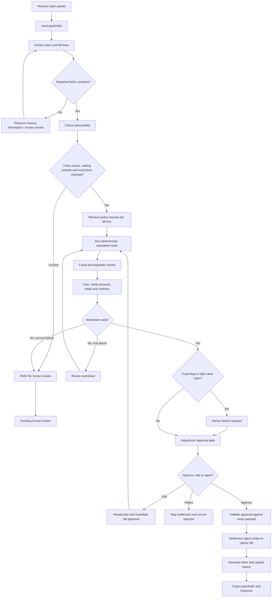

# ClaimSense

Health-insurance claim adjudication: read a hospitalisation claim, check every bill line against the
Arogya Sanjeevani policy wording, compute rupee amounts in tested code, and prepare a settlement for
a claims adjudicator to approve. Agentic AI Capstone, team of six.

## Start everything with one command

```bash
docker compose up --build
```

It needs only Docker (on Windows: `winget install -e --id Docker.DockerDesktop`, then start Docker
Desktop once). No key and no other setup: the agents run in stub mode, which is free and gives the
same answer every time.

| What starts | Where |
|---|---|
| Case UI for the adjudicator | http://127.0.0.1:8501 · sign in with `local-alice` (adjudicator) and `local-bob` (senior) |
| Case API, with interactive docs | http://127.0.0.1:8000/docs |
| Grafana, opening on the operations dashboard: claims processed, edit rate, rupees deducted by reason, fraud flags, turnaround, cost per claim | http://127.0.0.1:3000 |
| Prometheus, scraping the case API, with the edit-rate alert | http://127.0.0.1:9090 |
| Chroma vector store | http://127.0.0.1:8001 |

- **The demo:** in the case UI, start the three scenes in order: the room-rent cut explained line
  by line, the injected "pre-approved" note and the duplicate bill, and an edit that voids the
  approval. Steps: [src/claimsense/ui/README.md](src/claimsense/ui/README.md) · scripted:
  [docs/DEMO_SCRIPT.md](docs/DEMO_SCRIPT.md).
- **Stop:** Ctrl+C, then `docker compose down` (add `--volumes` to also clear the saved cases and
  dashboards).
- **Real models (paid):** copy `.env.example` to `.env`, set `OPENROUTER_API_KEY` and
  `CLAIMSENSE_LLM=real`, then run the same command.
- The ports listen on this machine only, and the demo tokens are for local use. Anywhere else, set
  `CLAIMSENSE_REVIEWERS` in `.env` to long random tokens.

The CI `compose` job runs this stack on every push and checks each row of the table.

## What we submit

| Item | Where |
|---|---|
| One command that starts everything | the section above · [docker-compose.yml](docker-compose.yml) |
| Architecture diagram | [docs/diagrams/langgraph-claim-flow.svg](docs/diagrams/langgraph-claim-flow.svg) · system flow: [docs/diagrams/claimsense-flow.svg](docs/diagrams/claimsense-flow.svg) · claim workflow: below |
| Numbered walkthrough of one request | [docs/TECHNICAL_WORKFLOW.md](docs/TECHNICAL_WORKFLOW.md), section 3 |
| Threat model | [docs/threat-model/THREAT_MODEL.md](docs/threat-model/THREAT_MODEL.md) |
| Memory policy | [docs/memory-policy.md](docs/memory-policy.md) |
| Evaluation report (4–6 pages) | [docs/EVALUATION_REPORT.md](docs/EVALUATION_REPORT.md) · [Word](docs/ClaimSense_Evaluation_Report.docx) · [PDF](docs/ClaimSense_Evaluation_Report.pdf) |
| Experiment log | E1, E2, E4: [eval/experiments/README.md](eval/experiments/README.md) · E3 (Reflexion): [docs/experiments/reflexion/REPORT-SECTION.md](docs/experiments/reflexion/REPORT-SECTION.md), [docs/REFLEXION_WORK_LOG.md](docs/REFLEXION_WORK_LOG.md) |
| Contribution log | [CONTRIBUTIONS.md](CONTRIBUTIONS.md) · personal logs: [CONTRIBUTIONS_SB.md](CONTRIBUTIONS_SB.md), [CONTRIBUTIONS_SS.md](CONTRIBUTIONS_SS.md) |
| Slides | to be added |
| Backup demo recording | to be added (the scenes it shows: [docs/DEMO_SCRIPT.md](docs/DEMO_SCRIPT.md)) |

No API keys or private data: `.env` and the course notebooks with keys are git-ignored, every claim
is synthetic, and the tracked files were scanned for key patterns (14 November 2026).

## Develop and test without Docker

```bash
python -m venv .venv
source .venv/Scripts/activate        # Windows Git Bash (PowerShell: .\.venv\Scripts\Activate.ps1; macOS/Linux: .venv/bin/activate)
pip install -r requirements.txt      # everything; or only your area's extras, e.g. pip install -e ".[dev,agents]"
pytest                               # product tests, no key needed
```

The case API and the case UI without Docker (two terminals, stub or real models):
[src/claimsense/ui/README.md](src/claimsense/ui/README.md). Every command of the project, with
its cost: [docs/COMMAND_REFERENCE.md](docs/COMMAND_REFERENCE.md)
([PDF](docs/ClaimSense_Command_Reference.pdf)).

No API key is needed for the tests or the eval suite: without `OPENROUTER_API_KEY` (or with
`CLAIMSENSE_LLM=stub`) the agents run on deterministic fallbacks. A real model run needs the key
in `.env`.

## Run and evaluate
```bash
python scripts/run_one.py --list                 # the dev claims
python scripts/run_one.py <claim_id>             # one claim, real model, node-by-node trace

python -m eval.harness.suite                     # whole eval suite vs expected outcomes; no key, seconds
python -m eval.harness.run --adapter claimsense --split dev,redteam --label <name>   # one scored run
python -m eval.agent_suite --stub --label <name> # what the agents did: traces, process metrics, gate
python -m eval.full --stub --label <name>        # harness + agent suite on one pipeline pass
python -m eval.monitoring setup                  # once: local Prometheus + Grafana (no Docker)
python -m eval.monitoring run --stub --label <name> --open   # 4-minute live drill with alerts
python -m eval.observability show --stub         # one claim as an OpenTelemetry trace, printed
python -m eval.observability setup               # once: local Jaeger trace viewer (no Docker)
python -m eval.observability run --stub --label <name> --keep   # traces to Jaeger, normal + outage
DEEPEVAL_DISABLE_DOTENV=1 DEEPEVAL_TELEMETRY_OPT_OUT=1 CLAIMSENSE_LLM=stub deepeval test run eval/deepeval_suite   # DeepEval unit tests (needs .[deepeval])
python -m eval.tools.rubric_score                # framework rubric scorecard
pytest eval/tests -q                             # eval tests (not part of the default `pytest`)

python -X utf8 -m eval.ship --label <name> --stub        # EVERY eval stage, one verdict: SHIP / DO NOT SHIP
python -X utf8 -m eval.agentic.run --label <name>        # tool calls, tools, hooks, final DB state (offline)
python -X utf8 -m eval.experiments.run --experiment E1 --label <name> --stub   # E1, E2, E4 from config files
python -X utf8 -m eval.experiments.e3 learn --reviewer "<name>" --out <dir>   # E3: lessons, with their cost
python -X utf8 -m eval.calibration.collect collect       # judge calibration: items, rater sheets, Cohen's kappa
pytest eval/agentic/tests eval/ship/tests eval/experiments/tests eval/calibration/tests
```
`--stub` keeps a run free. Without it, a key in your terminal makes the agents call paid models.
More in [eval/README.md](eval/README.md). The one-command ship check, step by step:
[docs/SHIP_CHECK.md](docs/SHIP_CHECK.md).

## Documentation
- **[Evaluation report](docs/EVALUATION_REPORT.md)**: every measured result against the capstone
  brief, the limits and the recommendations, in 4 to 6 pages
  ([Word](docs/ClaimSense_Evaluation_Report.docx) · [PDF](docs/ClaimSense_Evaluation_Report.pdf))
- **[Command reference](docs/COMMAND_REFERENCE.md)**: every terminal command of the project, with its
  purpose and cost ([PDF](docs/ClaimSense_Command_Reference.pdf))
- **[Threat model](docs/threat-model/THREAT_MODEL.md)** and **[memory policy](docs/memory-policy.md)**
- **[What changed in Phases 1 to 3](docs/CHANGE_REPORT_PHASES_1_TO_3.md)**: before and after for CI,
  the case API, the tools over MCP, the case UI and Docker (12 to 14 November 2026), and what each
  role should review
- **[Team guide](docs/TEAM_GUIDE.md)**: workflow diagram, how each member sets up and runs the code, the
  test and eval sets, scoring ([PDF](docs/ClaimSense_Team_Guide.pdf) ·
  [Word](docs/ClaimSense_Team_Guide.docx)). Rebuild: `python scripts/build_team_guide.py`
- **[Technical workflow paper](docs/TECHNICAL_WORKFLOW.md)** — architecture, end-to-end request flow,
  money calculation, approval, playbook, security, evaluation, team workflow, plan
  ([PDF](docs/ClaimSense_Technical_Workflow.pdf))
- **[Eval harness report](docs/EVAL_HARNESS_REPORT.md)**: what the harness measures, current results
  and open limitations ([Word](docs/ClaimSense_Eval_Harness_Report.docx)) ·
  [run guide](docs/EVAL_RUN_GUIDE.md) · [framework rubric score](docs/FRAMEWORK_RUBRIC_SCORE.md)
- **[Technical report: evaluation and monitoring](docs/TECHNICAL_REPORT_EVAL_AND_MONITORING.md)**:
  everything from the eval harness to live monitoring in one ASD-STE100-style report: results,
  defects, cost, recommendations, procedures
  ([Word](docs/ClaimSense_Technical_Report_Eval_and_Monitoring.docx))
- **[Agent suite report](docs/AGENT_SUITE_REPORT.md)**: traces of what the agents do, and the
  combined run · [harness vs agent suite note](docs/EvalSuite_AgentSuite_Note.md)
- **[Monitoring report card](docs/MONITORING_REPORT_CARD.md)**: live traffic, Prometheus, Grafana,
  alerts, the incident drill, the A/B test, real-model cost, hand-off to Deploy & Ops
- **[Observability report](docs/OBSERVABILITY_REPORT.md)**: production eval tools (DeepEval, RAGAS
  and others), the DeepEval suite, OpenTelemetry tracing the simple and the production way
  (Jaeger, Langfuse, LangSmith over OTLP), results, an adversarial review, and a step-by-step
  terminal guide for stub and real runs
  ([Word](docs/ClaimSense_Observability_Report.docx))
- **[Security report card](docs/SECURITY_REPORT_CARD.md)**: L15 guardrails and defences, the
  red-team scoreboard, open items, and how to check it with the real API ·
  [every change, before and after](docs/GUARDRAILS_BEFORE_AFTER.md)
- **[Claims and gold-set fixes](docs/CLAIMS_AND_GOLD_SET_FIXES.md)**: audit of the dev set, what is
  fixed and what is still open
- **[Ship check](docs/SHIP_CHECK.md)**: every evaluation in one command and one verdict, with the
  last stub and real results
- **[CI/CD pipeline](docs/CI_CD_PIPELINE.md)**: what runs on every push (lint, tests, the keyless
  eval gate, the one-command stack), the manual real-model gate, thresholds, how to read a red
  build, what CD still lacks
- **[Tool-use evaluation report](eval/agentic/REPORT.md)**: how the agents call tools, tool and
  hook correctness, final database state, attack coverage, open defects AGENTIC-nn
- **[Experiments E1-E4](eval/experiments/README.md)**: each experiment as config files, one
  harness: agent vs fixed workflow (E1), defences off/on (E2), lessons (E3), who computes the
  rupees (E4) · [judge calibration](eval/calibration/README.md)
- **Flow diagram:** [SVG](docs/diagrams/claimsense-flow.svg) · editable
  [Excalidraw](docs/diagrams/claimsense-flow.excalidraw) (open at excalidraw.com → Open)
- Rebuild after editing: `python scripts/build_diagram.py && python scripts/build_pdf.py`


## Where things go

| Folder | What |
|---|---|
| `src/claimsense/contracts/` | Shared Pydantic types: Claim, Worksheet, ApprovalToken, Lesson, Handoff |
| `src/claimsense/calc/` | The adjudication calculator — all rupee maths |
| `src/claimsense/mcp_servers/` | MCP servers: policy-kb, tariff, claims-db (with the approval store) |
| `src/claimsense/guardrails/`, `hooks/` | Input/output guardrails; per-claim tool ACL, budget and audit |
| `src/claimsense/ingestion/` | Policy PDF → clauses → retrieval corpus ([README](src/claimsense/ingestion/README.md)) |
| `src/claimsense/retrieval/` | Hybrid search over the clauses: Chroma + BM25 + reranker ([README](src/claimsense/retrieval/README.md)) |
| `data/` | Synthetic starter pack: policy PDFs, tariffs, processed clauses, knowledge base ([README](data/README.md)) |
| `src/claimsense/graph/`, `agents/`, `reflexion/` | LangGraph supervisor, specialists, playbook loop |
| `src/claimsense/api/`, `ui/` | Case API (FastAPI, streaming review) and the adjudicator's case UI (Streamlit) |
| `monitoring/` | Prometheus config, the edit-rate alert and Grafana's operations dashboard, mounted by `docker-compose.yml` |
| `eval/` | Harness, agent suite, live monitoring, observability (OpenTelemetry), DeepEval suite, dev golden set, red-team suite; `ship/` one-command verdict, `agentic/` tool-use eval, `experiments/` E1-E4 configs, `calibration/` judge kappa. The held-out set (`data/claimsense-heldout/`) is run once, by Eval & Red-Team only |
| `docs/` | ADRs, experiments, threat model, memory policy, reports |
| `course/`, `exercises/<name>/` | HW2-style course kit: build the agent yourself, six TODOs ([README](course/README.md)) |

## Claim workflow

How one claim moves from packet to settlement. Diamonds are decisions; every rupee comes from the
deterministic calculation tools, and nothing is paid without an approval tied to the exact worksheet.



## License
MIT — see [LICENSE](LICENSE).
