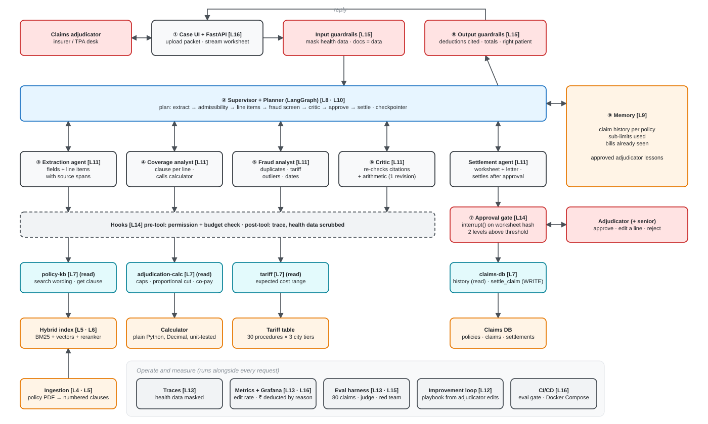
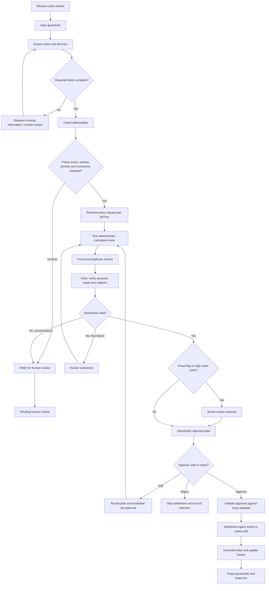

# ClaimSense

Health-insurance claim adjudication: read a hospitalisation claim, check every bill line against the
Arogya Sanjeevani policy wording, compute rupee amounts in tested code, and prepare a settlement for
a claims adjudicator to approve. Agentic AI Capstone, team of six.

## Quick start
```bash
python -m venv .venv
source .venv/Scripts/activate        # Windows Git Bash  (macOS/Linux: .venv/bin/activate)
pip install -e ".[dev]"
pytest
uvicorn claimsense.api.main:app --reload   # http://localhost:8000/health
```
Full stack (needs Docker): `cp .env.example .env` then `docker compose up`.
Grafana: http://localhost:3000 · Prometheus: http://localhost:9090

Install extras for your area: `pip install -e ".[dev,agents,mcp,retrieval]"` (others: `course`,
`docs`, `eval`). Or install everything in one step: `pip install -r requirements.txt`.

No API key is needed for the tests or the eval suite: without `OPENROUTER_API_KEY` (or with
`CLAIMSENSE_LLM=stub`) the agents run on deterministic fallbacks. A real model run needs the key
in `.env`.

## Run and evaluate
```bash
python scripts/run_one.py --list                 # the dev claims
python scripts/run_one.py <claim_id>             # one claim, real model, node-by-node trace

python -m eval.harness.suite                     # whole eval suite vs expected outcomes; no key, seconds
python -m eval.harness.run --adapter claimsense --split dev,redteam --label <name>   # one scored run
python -m eval.agent_suite --stub --label <name> # what the agents did: traces, process metrics, gate
python -m eval.full --stub --label <name>        # harness + agent suite on one pipeline pass
python -m eval.monitoring setup                  # once: local Prometheus + Grafana (no Docker)
python -m eval.monitoring run --stub --label <name> --open   # 4-minute live drill with alerts
python -m eval.observability show --stub         # one claim as an OpenTelemetry trace, printed
python -m eval.observability setup               # once: local Jaeger trace viewer (no Docker)
python -m eval.observability run --stub --label <name> --keep   # traces to Jaeger, normal + outage
DEEPEVAL_DISABLE_DOTENV=1 DEEPEVAL_TELEMETRY_OPT_OUT=1 CLAIMSENSE_LLM=stub deepeval test run eval/deepeval_suite   # DeepEval unit tests (needs .[deepeval])
python -m eval.tools.rubric_score                # framework rubric scorecard
pytest eval/tests -q                             # eval tests (not part of the default `pytest`)

python -X utf8 -m eval.ship --label <name> --stub        # EVERY eval stage, one verdict: SHIP / DO NOT SHIP
python -X utf8 -m eval.agentic.run --label <name>        # tool calls, tools, hooks, final DB state (offline)
python -X utf8 -m eval.experiments.run --experiment E1 --label <name> --stub   # E1, E2, E4 from config files
python -X utf8 -m eval.experiments.e3 learn --reviewer "<name>" --out <dir>   # E3: lessons, with their cost
python -X utf8 -m eval.calibration.collect collect       # judge calibration: items, rater sheets, Cohen's kappa
pytest eval/agentic/tests eval/ship/tests eval/experiments/tests eval/calibration/tests
```
`--stub` keeps a run free. Without it, a key in your terminal makes the agents call paid models.
More in [eval/README.md](eval/README.md). The one-command ship check, step by step:
[docs/SHIP_CHECK.md](docs/SHIP_CHECK.md).

## Documentation
- **[Team guide](docs/TEAM_GUIDE.md)**: workflow diagram, how each member sets up and runs the code, the
  test and eval sets, scoring ([PDF](docs/ClaimSense_Team_Guide.pdf) ·
  [Word](docs/ClaimSense_Team_Guide.docx)). Rebuild: `python scripts/build_team_guide.py`
- **[Technical workflow paper](docs/TECHNICAL_WORKFLOW.md)** — architecture, end-to-end request flow,
  money calculation, approval, playbook, security, evaluation, team workflow, plan
  ([PDF](docs/ClaimSense_Technical_Workflow.pdf))
- **[Eval harness report](docs/EVAL_HARNESS_REPORT.md)**: what the harness measures, current results
  and open limitations ([Word](docs/ClaimSense_Eval_Harness_Report.docx)) ·
  [run guide](docs/EVAL_RUN_GUIDE.md) · [framework rubric score](docs/FRAMEWORK_RUBRIC_SCORE.md)
- **[Technical report: evaluation and monitoring](docs/TECHNICAL_REPORT_EVAL_AND_MONITORING.md)**:
  everything from the eval harness to live monitoring in one ASD-STE100-style report: results,
  defects, cost, recommendations, procedures
  ([Word](docs/ClaimSense_Technical_Report_Eval_and_Monitoring.docx))
- **[Agent suite report](docs/AGENT_SUITE_REPORT.md)**: traces of what the agents do, and the
  combined run · [harness vs agent suite note](docs/EvalSuite_AgentSuite_Note.md)
- **[Monitoring report card](docs/MONITORING_REPORT_CARD.md)**: live traffic, Prometheus, Grafana,
  alerts, the incident drill, the A/B test, real-model cost, hand-off to Deploy & Ops
- **[Observability report](docs/OBSERVABILITY_REPORT.md)**: production eval tools (DeepEval, RAGAS
  and others), the DeepEval suite, OpenTelemetry tracing the simple and the production way
  (Jaeger, Langfuse, LangSmith over OTLP), results, an adversarial review, and a step-by-step
  terminal guide for stub and real runs
  ([Word](docs/ClaimSense_Observability_Report.docx))
- **[Security report card](docs/SECURITY_REPORT_CARD.md)**: L15 guardrails and defences, the
  red-team scoreboard, open items, and how to check it with the real API ·
  [every change, before and after](docs/GUARDRAILS_BEFORE_AFTER.md)
- **[Claims and gold-set fixes](docs/CLAIMS_AND_GOLD_SET_FIXES.md)**: audit of the dev set, what is
  fixed and what is still open
- **[Ship check](docs/SHIP_CHECK.md)**: every evaluation in one command and one verdict, with the
  last stub and real results
- **[CI/CD pipeline](docs/CI_CD_PIPELINE.md)**: what runs on every push (lint, tests, the keyless
  eval gate), the manual real-model gate, thresholds, how to read a red build, what CD still lacks
- **[Tool-use evaluation report](eval/agentic/REPORT.md)**: how the agents call tools, tool and
  hook correctness, final database state, attack coverage, open defects AGENTIC-nn
- **[Experiments E1-E4](eval/experiments/README.md)**: each experiment as config files, one
  harness: agent vs fixed workflow (E1), defences off/on (E2), lessons (E3), who computes the
  rupees (E4) · [judge calibration](eval/calibration/README.md)
- **Flow diagram:** [SVG](docs/diagrams/claimsense-flow.svg) · editable
  [Excalidraw](docs/diagrams/claimsense-flow.excalidraw) (open at excalidraw.com → Open)
- Rebuild after editing: `python scripts/build_diagram.py && python scripts/build_pdf.py`



## Where things go
See `CLAUDE.md` for the folder → role map and the rules every contributor (and Claude) follows.

| Folder | What |
|---|---|
| `src/claimsense/contracts/` | Shared Pydantic types: Claim, Worksheet, ApprovalToken, Lesson, Handoff |
| `src/claimsense/calc/` | The adjudication calculator — all rupee maths |
| `src/claimsense/mcp_servers/` | MCP servers: policy-kb, tariff, claims-db (with the approval store) |
| `src/claimsense/guardrails/`, `hooks/` | Input/output guardrails; per-claim tool ACL, budget and audit |
| `src/claimsense/ingestion/` | Policy PDF → clauses → retrieval corpus ([README](src/claimsense/ingestion/README.md)) |
| `src/claimsense/retrieval/` | Hybrid search over the clauses: Chroma + BM25 + reranker ([README](src/claimsense/retrieval/README.md)) |
| `data/` | Synthetic starter pack: policy PDFs, tariffs, processed clauses, knowledge base ([README](data/README.md)) |
| `src/claimsense/graph/`, `agents/`, `reflexion/` | LangGraph supervisor, specialists, playbook loop |
| `eval/` | Harness, agent suite, live monitoring, observability (OpenTelemetry), DeepEval suite, dev golden set, red-team suite (held-out set lives outside the repo); `ship/` one-command verdict, `agentic/` tool-use eval, `experiments/` E1-E4 configs, `calibration/` judge kappa |
| `docs/` | ADRs, experiments, threat model, memory policy, meetings |
| `course/`, `exercises/<name>/` | HW2-style course kit: build the agent yourself, six TODOs ([README](course/README.md)) |

## Working with Claude Code
1. Open this folder in VS Code and start `claude`.
2. Plan mode (Shift+Tab) → *"Read issue T15 and contracts/. Plan the change; don't code yet."*
3. Review the plan, write the key test cases yourself, then let Claude implement.
4. `/code-review` before opening a PR. One reviewer from another role.

Project hooks (`.claude/settings.json`) auto-format with ruff after every edit and block reading `.env` and the held-out eval set.

## Claim workflow

How one claim moves from packet to settlement. Diamonds are decisions; every rupee comes from the
deterministic calculation tools, and nothing is paid without an approval tied to the exact worksheet.



## License
MIT — see [LICENSE](LICENSE).
