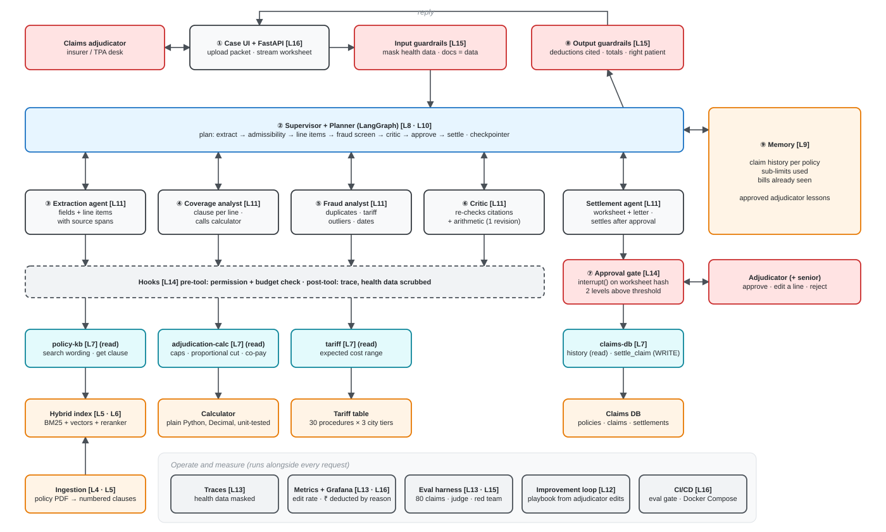
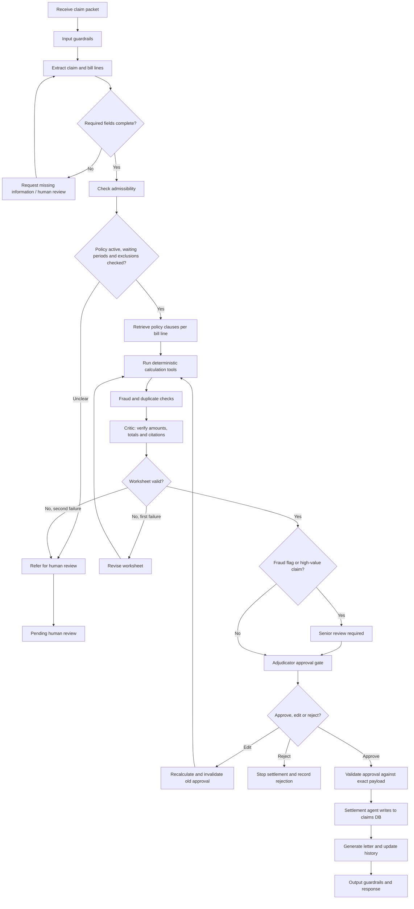

# ClaimSense

Health-insurance claim adjudication: read a hospitalisation claim, check every bill line against the
Arogya Sanjeevani policy wording, compute rupee amounts in tested code, and prepare a settlement for
a claims adjudicator to approve. Agentic AI Capstone, team of six.

## Quick start
```bash
python -m venv .venv
source .venv/Scripts/activate        # Windows Git Bash  (macOS/Linux: .venv/bin/activate)
pip install -e ".[dev]"
pytest
uvicorn claimsense.api.main:app --reload   # http://localhost:8000/health
```
Full stack (needs Docker): `cp .env.example .env` then `docker compose up`.
Grafana: http://localhost:3000 · Prometheus: http://localhost:9090

Install extras for your area: `pip install -e ".[dev,agents,mcp,retrieval]"`.

## Documentation
- **[Team guide](docs/TEAM_GUIDE.md)**: workflow diagram, how each member sets up and runs the code, the
  test and eval sets, scoring ([PDF](docs/ClaimSense_Team_Guide.pdf) ·
  [Word](docs/ClaimSense_Team_Guide.docx)). Rebuild: `python scripts/build_team_guide.py`
- **[Technical workflow paper](docs/TECHNICAL_WORKFLOW.md)** — architecture, end-to-end request flow,
  money calculation, approval, playbook, security, evaluation, team workflow, plan
  ([PDF](docs/ClaimSense_Technical_Workflow.pdf))
- **Flow diagram:** [SVG](docs/diagrams/claimsense-flow.svg) · editable
  [Excalidraw](docs/diagrams/claimsense-flow.excalidraw) (open at excalidraw.com → Open)
- Rebuild after editing: `python scripts/build_diagram.py && python scripts/build_pdf.py`



## Where things go
See `CLAUDE.md` for the folder → role map and the rules every contributor (and Claude) follows.

| Folder | What |
|---|---|
| `src/claimsense/contracts/` | Shared Pydantic types: Claim, Worksheet, ApprovalToken, Lesson, Handoff |
| `src/claimsense/calc/` | The adjudication calculator — all rupee maths |
| `src/claimsense/mcp_servers/` | policy-kb, adjudication-calc, tariff, claims-db |
| `src/claimsense/ingestion/` | Policy PDF → clauses → retrieval corpus ([README](src/claimsense/ingestion/README.md)) |
| `data/` | Synthetic starter pack: policy PDFs, tariffs, processed clauses, knowledge base ([README](data/README.md)) |
| `src/claimsense/graph/`, `agents/`, `reflexion/` | LangGraph supervisor, specialists, playbook loop |
| `eval/` | Harness, dev golden set, red-team suite (held-out set lives outside the repo) |
| `docs/` | ADRs, experiments, threat model, memory policy, meetings |
| `course/`, `exercises/<name>/` | HW2-style course kit: build the agent yourself, six TODOs ([README](course/README.md)) |

## Working with Claude Code
1. Open this folder in VS Code and start `claude`.
2. Plan mode (Shift+Tab) → *"Read issue T15 and contracts/. Plan the change; don't code yet."*
3. Review the plan, write the key test cases yourself, then let Claude implement.
4. `/code-review` before opening a PR. One reviewer from another role.

Project hooks (`.claude/settings.json`) auto-format with ruff after every edit and block reading `.env`.

## Claim workflow

How one claim moves from packet to settlement. Diamonds are decisions; every rupee comes from the
deterministic calculation tools, and nothing is paid without an approval tied to the exact worksheet.


