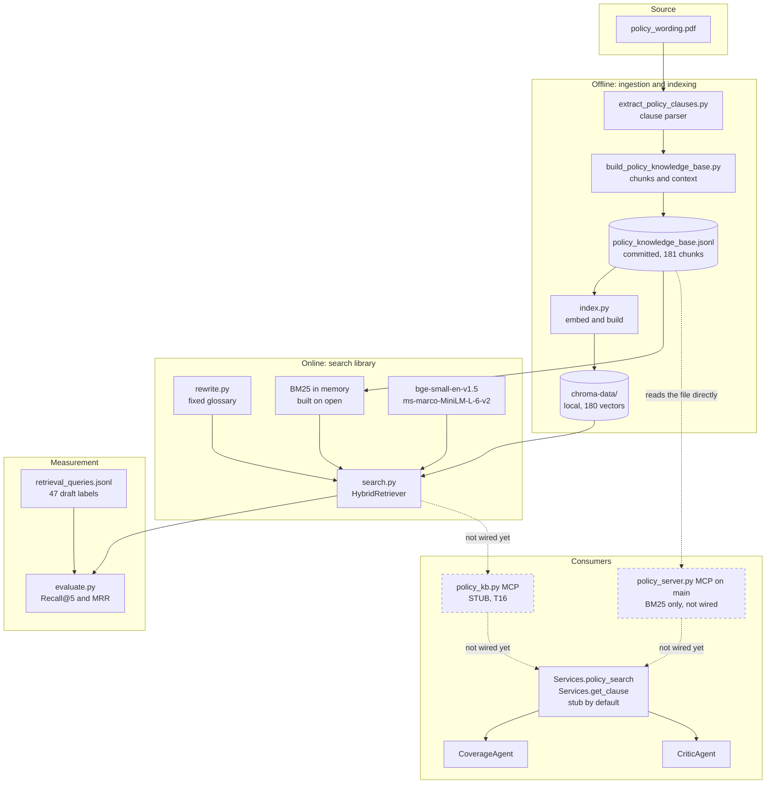
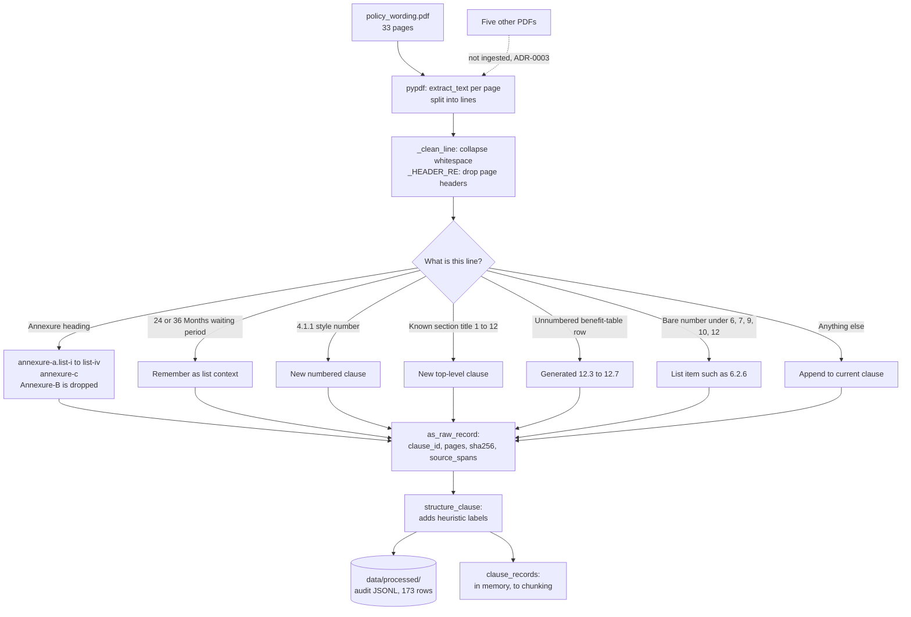
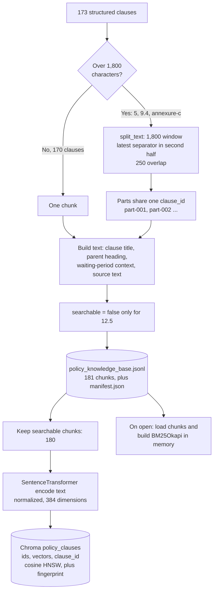
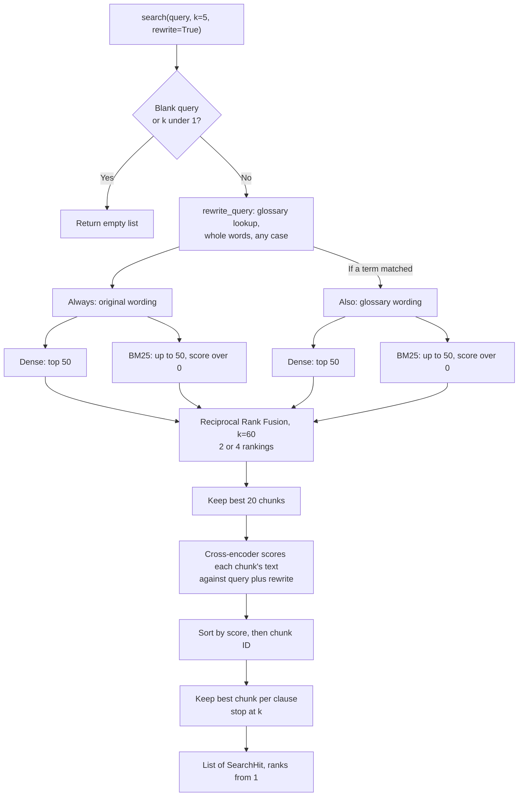
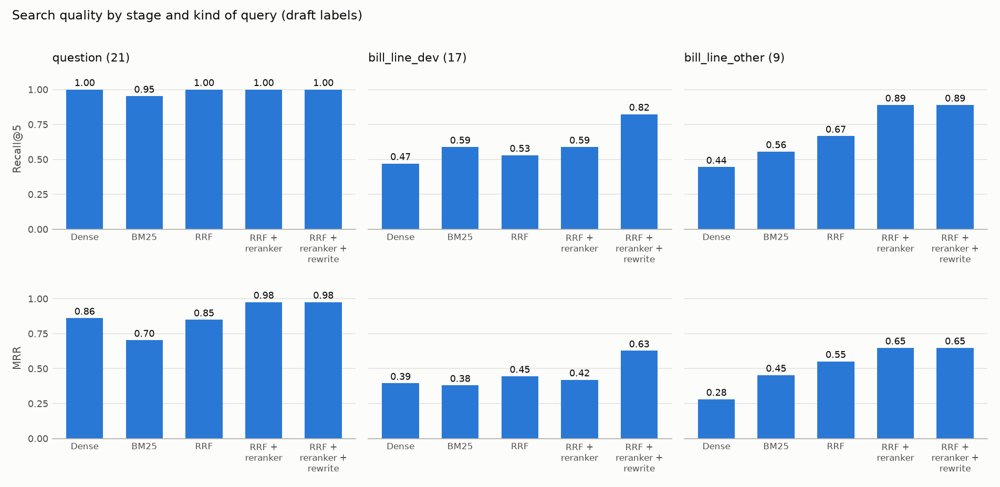
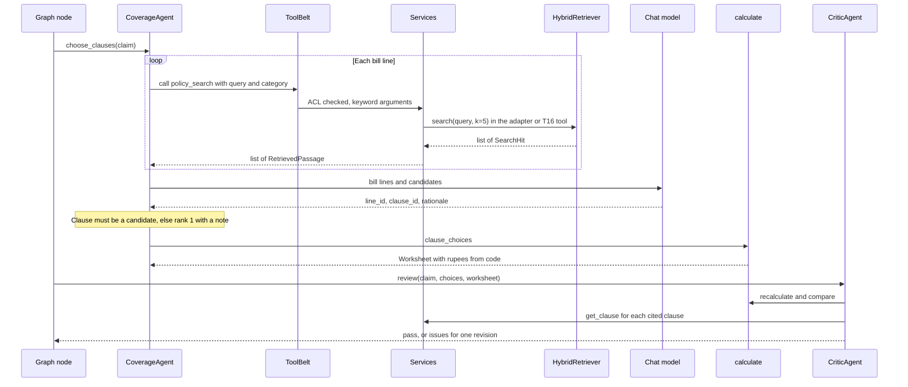

# RAG Architecture and Implementation

**For:** Spandan and anyone building on policy search. **Written:** 2026-11-03, from the code on `shashank/t11-query-rewrite` (`94d31a8`) and `main` (`688109b`). **Owner:** Knowledge & Memory.

This describes what the code does today. Anything not built is labelled.

| Label | Meaning |
|---|---|
| **Implemented** | Code exists, is tested and runs |
| **Partial** | Works, with a stated gap |
| **Stub** | Code exists but returns a placeholder or raises |
| **Planned** | No code yet |

## Start here
**Search works, and you can build against it now.** It is a Python library, not a service: no MCP tool or HTTP endpoint serves it yet. A separate, keyword-only policy server was added to `main` on 2026-11-03. It doesn't use this search, so read [the comparison](#two-policy-servers-and-the-search-library) before wiring it in.

If you only read one part, read [section 14](#14-rag-to-agents-handoff). To try it now:

```bash
git switch main
```

```bash
git pull
```

```bash
pip install -e ".[dev,agents,retrieval]"
```

```bash
python -m claimsense.retrieval.index
```

```python
from claimsense.retrieval.index import open_retriever

retriever = open_retriever()  # takes about 30 s, so do this once per process
for hit in retriever.search("OT charges", k=5):
    print(hit.rank, hit.clause_id, hit.title)
```

Run these from the repository root, because `config/models.yaml` is found relative to the current folder. The first run downloads two models from Hugging Face. The index and search steps were run in this repo's existing environment. The `pip install` line wasn't tested in a clean one, and that environment doesn't have `langgraph` from the `agents` extra.

## 1. Overall architecture and project structure
The pipeline has two halves. An offline half turns the policy PDF into a committed JSONL knowledge base and a local index. An online half answers a query from that index.

**Complete RAG architecture:**



| Layer | Status | Where |
|---|---|---|
| PDF text and clause extraction | **Implemented** | `src/claimsense/ingestion/extract_policy_clauses.py` |
| Chunking and knowledge base | **Implemented** | `src/claimsense/ingestion/build_policy_knowledge_base.py` |
| Embedding and vector index | **Implemented** (local only) | `src/claimsense/retrieval/index.py` |
| Hybrid search and reranking | **Implemented** | `src/claimsense/retrieval/search.py` |
| Bill-line query rewrite | **Implemented** (glossary, no model) | `src/claimsense/retrieval/rewrite.py` |
| Retrieval scoring | **Implemented** (draft labels) | `src/claimsense/retrieval/evaluate.py` |
| MCP tool over this search | **Stub** | `src/claimsense/mcp_servers/policy_kb.py` |
| Separate keyword-only MCP server | **Partial**, on `main`, not wired | `src/claimsense/mcp_servers/policy_server.py` |
| Agents using real search | **Planned** (agents use a stub today) | `src/claimsense/agents/services.py` |
| Answer generation over retrieved text | **Not part of this design** | Agents select clauses; code computes rupees |

```text
data/policy/new_india/policy_wording.pdf        source of truth; five other PDFs sit beside it
data/processed/                                 audit output from the clause parser
data/knowledge_base/policy_knowledge_base.jsonl the corpus: committed, regenerated, never hand-edited
data/knowledge_base/manifest.json               hashes, counts, limitations
src/claimsense/ingestion/                       PDF to clauses to chunks
src/claimsense/retrieval/                       index, search, rewrite, evaluate
config/models.yaml                              embedding and reranker model names
chroma-data/                                    local vector index; gitignored; build it yourself
eval/golden_dev/retrieval_queries.jsonl         47 draft search labels
tests/ingestion/, tests/retrieval/              83 tests
runs/retrieval_t11.png                          latest score chart
```

Run `python -m claimsense.retrieval.index` again after regenerating the knowledge base.

## 2. Document ingestion and text extraction
**Status: Implemented.**

Only `data/policy/new_india/policy_wording.pdf` (33 pages) is ingested. [ADR-0003](adr/0003-policy-corpus-scope.md) explains why:

| Source | Chunked? | Reason |
|---|---|---|
| Wording clauses 1–12, Annexure-A Lists I–IV, Annexure-C | Yes | The contract and its annexures |
| Annexure-B ombudsman addresses | No | No claim rule |
| `excluded_items.pdf` | No | Repeats List I; a test keeps that checked |
| CIS, prospectus | No | Lower authority; could outrank the clause they summarise |
| Proposal and claim forms | No | Blank forms |
| Claims, gold worksheets, tariffs | Never | Rule 5 for gold; tariffs are served by the tariff tool |

Extraction uses `pypdf`: `PdfReader(path)`, then `page.extract_text()` per page, split into lines by `splitlines()`. There is no OCR or table parser, so text inside images would be lost. A known defect: `pypdf` splits some words, such as "ins ured" (57 occurrences), and nothing repairs them.

There are two entry points, and they share the parser:

| Command | What it does | Writes |
|---|---|---|
| `python -m claimsense.ingestion.extract_policy_clauses` | `run_pipeline`: parses and structures clauses for audit | `data/processed/extracted_clauses_raw.jsonl`, `policy_clauses_structured.jsonl` |
| `python -m claimsense.ingestion.build_policy_knowledge_base` | `build_knowledge_base`: parses in memory, then chunks | `data/knowledge_base/policy_knowledge_base.jsonl`, `manifest.json` |

The builder never reads `data/processed/`. It also checks that every chunk's SHA-256 matches the PDF and refuses to write duplicate chunk IDs. A test (`test_committed_knowledge_base_matches_a_fresh_build`) confirms the committed file matches a fresh build.

**Document ingestion:**



## 3. Preprocessing and metadata extraction
**Status: Implemented. All labels are heuristic and `not_human_verified`.**

**Line cleaning.** `_clean_line` collapses tabs, non-breaking spaces and runs of spaces. Blank lines and page headers matching `_HEADER_RE` are dropped.

**Clause boundaries.** `extract_clauses` tests each line in this order:
1. **Annexure heading.** `_is_annexure` switches mode. Annexure-C becomes one clause, Annexure-A lines split on `List I` to `List IV`, and Annexure-B text is discarded.
2. **Waiting-period subheading**, like "(i) 24 Months waiting period". It is kept as `section_context` for the list items after it.
3. **Full number**, like `4.1.1`, through `_FULL_NUMBER_RE`.
4. **Top-level heading.** `_TOP_LEVEL_RE` plus `_is_top_level_heading`, which requires a known title from `_MAIN_HEADINGS`. Numbered prose doesn't reset the hierarchy this way.
5. **Benefit-table row** under section 12 (`_BENEFIT_ROWS`). The PDF prints no number, so `12.3` to `12.7` are generated.
6. **Bare list item** under sections 6, 7, 9, 10 or 12 (`_NUMBERED_LIST_ROOTS`). The number comes from its position, so `displayed_number` can differ: `6.2.21` is printed as "1" under the 36-month list.
7. **Anything else** is appended to the current clause.

The result is 173 clauses. The clause ID format is `new_india_arogya_sanjeevani:<clause_number>`, such as `new_india_arogya_sanjeevani:6.2.6`.

**Metadata on each chunk:**

| Field | Example or meaning | Source |
|---|---|---|
| `clause_id`, `clause_number`, `displayed_number` | `...:6.2.6`, `6.2.6`, `6` | Parser |
| `parent_clause_number`, `hierarchy` | `6.2`, `["6", "2", "6"]` | Parser |
| `title` | `Hysterectomy` | Parser |
| `source.document`, `source.sha256` | `policy_wording.pdf`, hash of the file | PDF |
| `source.page_number`, `source.page_numbers` | First page, all pages | Parser |
| `source.document_date`, `document_date_basis` | `2025-03-06`, `pdf_creation_metadata`. **Not an effective date** (ADR-0004) | PDF metadata |
| `source.insurer`, `product`, `uin_observed_in_policy_pdf` | Constants in `extract_policy_clauses.py` | Code |
| `chunk_id`, `chunk_index`, `chunk_count` | `clause::...:6.2.6::part-001`, `1`, `1` | Builder |
| `searchable`, `conflict` | `false` and a resolution only for `12.5` (ADR-0004) | `TABLE_CONFLICTS` |
| `proposed_interpretation` | Topic, rule type, conditions, exceptions, waiting-period spans, parent context. `numeric_threshold` is always `null` | `structure_clause` |
| `verification_status`, `authority_level` | `not_human_verified`, `primary_policy_wording` | Builder |
| `retrieval_warning` | Warns that interpretation isn't verified | Builder |

`proposed_interpretation` comes from keyword and regex matching (`_topic`, `_CONDITION_RE`, `_EXCEPTION_RE`, `_DURATION_RE`). Search doesn't use it, and `SearchHit` doesn't return it. **Don't decide coverage from it.**

**Wording conflict.** Table row `12.5` says 4 years, while clause `6.1` says 36 months. ADR-0004 ruled that where they disagree the clause wins, so `12.5` stays for audit with `searchable: false`. These are calls for a demo on synthetic claims, not an insurer's ruling.

## 4. Chunking strategy
**Status: Implemented.**

**Chunking follows the clause structure first. Character splitting applies only to clauses over the size limit.**

| Setting | Value | Where |
|---|---|---|
| Unit | One numbered clause or list item | `clause_records` |
| `DEFAULT_CHUNK_SIZE` | 1,800 characters of source text | `build_policy_knowledge_base.py` |
| `DEFAULT_OVERLAP` | 250 characters | `build_policy_knowledge_base.py` |
| Separators | `"\n\n"`, `"\n"`, `". "`, `"; "`, `" "` | `split_text` |

**How `split_text` works:**
1. `clean_pdf_text` removes null bytes and tidies whitespace, without rewording.
2. A window of 1,800 characters is taken from `start`.
3. If the text continues past it, each separator is searched for in the second half of the window (from `start + 900`).
4. **The latest position of any separator wins.** They aren't tried in priority order, so the cut is usually the last space or newline before the limit, not necessarily a paragraph or sentence end. If no separator exists, the cut is hard at 1,800.
5. The next window starts at `max(start + 1, end - 250)`.

**Result:** 173 clauses become 181 chunks. Only three clauses are long enough to split: `annexure-c` (7 parts), `5` (2) and `9.4` (2). `source_text` ranges from 13 to 1,799 characters, with a median of 271.

**Two text fields, with different jobs:**

| Field | Contains | Used for |
|---|---|---|
| `text` | Headings plus the source text. Up to 1,902 characters | Embedding, BM25, reranking; returned as `context_text` |
| `source_text` | Verbatim policy wording only | Quoting; returned as `text`; merged by `get_clause` |

The headings make terse list items searchable. Here is `6.2.6` in full. `source_text` is just `6. Hysterectomy`, and `text` is:

```text
Policy wording clause 6.2.6: Hysterectomy
Parent section 6.2: 6.2. Specific Waiting Period: (Code- Excl02)
Waiting-period section context: (i) 24 Months waiting period
Clause source text:
6. Hysterectomy
```

A list item carries only its own period. The parent's conditions stay in `proposed_interpretation.parent_context`, so they don't drown out the item's name. Clauses `6.1`, `6.2` and `6.3` have no list context, so they get up to 1,400 characters of their parent section.

**Chunking and indexing:**



## 5. Embedding model and generation
**Status: Implemented.**

| Item | Value |
|---|---|
| Model | `BAAI/bge-small-en-v1.5`, from `embeddings` in `config/models.yaml` |
| Library | `sentence-transformers`, through `load_embedder` |
| Call | `model.encode(list(texts), normalize_embeddings=True, show_progress_bar=False)` |
| Dimensions | 384 (read from the live index) |
| Input | The chunk's `text` field, not `source_text` |
| Query embedding | Same function, with no prefix |

The BGE query instruction prefix isn't used. That is a candidate experiment for T56. Batch size and device are library defaults, and this repo's measurements came from a CPU laptop.

## 6. Vector database and indexing strategy
**Status: Implemented for local use. The Docker service isn't connected.**

There are two indexes, both over the same 180 searchable chunks.

| | Dense | Lexical |
|---|---|---|
| Library | Chroma `PersistentClient`, embedded in the process | `rank_bm25.BM25Okapi` |
| Holds | IDs, vectors and `{"clause_id": ...}` metadata. **No documents** | Tokens from each chunk's `text` |
| Similarity | Cosine HNSW (`hnsw:space: cosine`) | BM25 |
| Lifetime | On disk | Rebuilt in memory each time the retriever opens |

Collection name: `policy_clauses`. Hits are joined back to the knowledge base by chunk ID, because Chroma stores no text.

`tokenize` lowercases, removes commas inside numbers (`10,000` becomes `10000`), keeps `[a-z0-9]+`, and changes `isation` to `ization`, because the wording spells hospitalisation both ways.

**Not connected:** `docker-compose.yml` runs a `chromadb/chroma:0.5.23` server and sets `CHROMA_HOST`, but no code reads `CHROMA_HOST`. The retriever always uses the local folder. A containerised search needs either a change here or the index built into the container's disk. This environment has `chromadb` 1.5.9, and that pairing with the 0.5.23 server hasn't been tested.

## 7. Index storage, persistence and retrieval
**Status: Implemented.**

| Item | Behaviour |
|---|---|
| Location | `chroma-data/` at the repo root; gitignored. Override with `--index-dir` |
| Corpus | `data/knowledge_base/policy_knowledge_base.jsonl`; committed; the source of truth |
| Build | `python -m claimsense.retrieval.index`; deletes and recreates the collection, so no old chunk survives |
| Build time | About 1 minute 10 seconds, including model load (CPU laptop) |
| Open time | About 30 seconds with `open_retriever`, mostly imports and model loading |
| Stale guard | `fingerprint` hashes the embedding model name plus each searchable chunk's ID and `text`, and is stored in the collection metadata |
| On mismatch | `open_collection` raises `StaleIndexError` naming the rebuild command. This fires before the models load |

**Gotcha:** `load_config` finds `config/models.yaml` relative to the current folder. From anywhere else, `open_retriever` raises `FileNotFoundError` unless `CLAIMSENSE_CONFIG` is set. Telemetry is off, and queries aren't logged because they can hold health details.

## 8. Query processing, search, Top-K, filtering and reranking
**Status: Implemented.**

**Query and retrieval:**



| Setting | Value | Where |
|---|---|---|
| Top-K returned | `k`, default 5. **Maximum 20**, because only 20 chunks are reranked | `search` |
| `CANDIDATES` | 50 per dense and BM25 list | `search.py` |
| `RRF_K` | 60 | `search.py` |
| `RERANK_POOL` | 20 chunks | `search.py` |
| Reranker | `cross-encoder/ms-marco-MiniLM-L-6-v2`, from `reranker` in `config/models.yaml` | `load_reranker` |

**Query rewrite.** `rewrite.py` holds a fixed glossary of 10 terms: `diagnostics`, `icu`, `laboratory`, `medicines`, `nursing`, `ot`, `pharmacy`, `rmo`, `room charges` and `ward`. For example, "OT charges" adds "operation theatre charges". It isn't a model, because bill text is untrusted: it never reaches an LLM here, and injected words can't enter the rewrite. The original wording always stays in the search. `search(query, rewrite=False)` turns it off.

**Filtering.** The only filter is `searchable`, applied when the index is built and when BM25 loads. **There is no metadata filter at query time.** No category, section or page filter exists, so the `category` argument that agents pass today can't be honoured.

**Scores.** `score` is the cross-encoder's raw output, and it can be negative: −1.07 and −2.04 for "OT charges". It only orders the hits of one query.

**No relevance threshold.** Search always returns its top results. "best biryani in Hyderabad" returns 3.6, 3.7 and 3.28 with scores near −11. Treat every hit as a candidate, not an answer.

**Rank 1 isn't always the answer.** "OT charges" ranks `annexure-a.list-iii` first and 4.1 second. The model has to choose from the candidates.

**Speed.** A search took 0.35 to 1.4 seconds in the latest run and about 2 seconds in an earlier one, nearly all in the reranker.

## 9. Context construction and LLM integration
**Status: The RAG layer has no LLM. Context is built in `agents/coverage.py`, with search stubbed by default. Partial.**

`retrieval/` and `ingestion/` make no model calls. They return passages and nothing more. The only models they run are the embedding model and cross-encoder.

The agents' flow in `CoverageAgent`:
1. `candidates` calls `policy_search` once per bill line, using `line.description` after the `REWRITE` replacements.
2. `_ask_model` builds one prompt holding room category, nights, diagnosis, procedure, then each bill line with its candidates as `clause_id: first 400 characters of text`. Playbook lessons and critic feedback are added when present.
3. The model returns `CoverageDecision`: for each line, a `line_id`, `clause_id` and one-sentence `rationale`.
4. `choose_clauses` rejects a `clause_id` outside that line's candidates and falls back to rank 1 with a note.
5. `calculate` turns the choices into rupees. No retrieved text reaches the calculator.

In stub mode (`CLAIMSENSE_LLM=stub`, or no `OPENROUTER_API_KEY`), `get_llm` returns `None` and coverage takes rank 1. Stub mode with real search is therefore not a fair test of real clause choice.

**Models:**

| Purpose | Read from | Value |
|---|---|---|
| Embedding, reranking | `config/models.yaml` | As in sections 5 and 8 |
| Agent chat models | `MODELS` in `agents/llm.py`, through OpenRouter | Hard-coded defaults, overridable by environment variables |

`agents/llm.py` doesn't read `config/models.yaml`, and the values differ. This breaks a project rule and is listed as AGT-09 in the [fixes list](CLAIMS_AND_GOLD_SET_FIXES.md).

## 10. Prompts, citations and hallucination handling
**Status: Partial, and all in `agents/`. The RAG layer has no prompts.**

**Prompts.** They are inline strings: `SYSTEM` in `coverage.py` and `extraction.py`, and inline strings in `critic.py` and `settlement.py`. `config/prompts/` is empty, and `prompts_dir` isn't read.

| Control | Status | How |
|---|---|---|
| Model can't compute rupees | **Implemented** | The output schema has no amounts; `calculate` is code |
| Model can only pick a retrieved clause | **Implemented** | `choose_clauses`, `coverage.py:138-143` |
| Every deduction cites a clause | **Implemented** | `Deduction.clause_id` is required |
| Cited clause exists | **Implemented** | `CriticAgent.review` calls `get_clause` |
| Clause supports the deduction | **Partial** | A model, or a keyword table in stub mode. Keywords fail on `6.2.x` list items and `7.15` with real `get_clause` text (AGT-13) |
| Arithmetic re-run | **Implemented** | The critic recalculates |
| A person approves the exact worksheet | **Implemented** | `ApprovalToken` tied to `Worksheet.content_hash` |
| Conflicting table row can't be retrieved | **Implemented** | `searchable: false` |
| Bill text marked as data in the coverage prompt | **Not done** | Only extraction calls `as_data`. `wrap_as_data` in `guardrails.py` delegates to it, but nothing calls that (AGT-04) |
| Citation to a page or chunk | **Partial** | `SearchHit` has both, but `RetrievedPassage` can't carry them until the contract PR |
| "Not found" when nothing is relevant | **Not implemented** | No threshold (section 8) |
| Rationale checked against the clause | **Not implemented** | The `judge` model isn't used |
| Input and output guardrails package | **Partial**, on `main`, not wired | `src/claimsense/guardrails/guardrails.py` has input and output checks, but no tests and no callers. Not run for this document. `hooks/` holds only a docstring |

## 11. APIs, schemas, functions and file responsibilities
**HTTP:** `src/claimsense/api/` serves `/health`, `/metrics/` and the case routes (start a claim, stream the run, decide its review; `src/claimsense/api/README.md`). No search endpoint exists.

### Python API
```text
open_retriever(kb_path=DEFAULT_KB, index_dir=DEFAULT_INDEX_DIR) -> HybridRetriever
HybridRetriever.search(query: str, k: int = 5, rewrite: bool = True) -> list[SearchHit]
HybridRetriever.get_clause(clause_id: str) -> FullClause | None
```

| Function | Purpose | Notes |
|---|---|---|
| `HybridRetriever.search` | Full pipeline | Use this. Blank query or `k < 1` returns `[]` |
| `HybridRetriever.get_clause` | One whole clause by ID | Merges split parts. Also returns `12.5`. Unknown ID returns `None` |
| `HybridRetriever.dense`, `lexical`, `fused`, `clause_ids` | Earlier stages | For measurement only |
| `open_retriever` | Loads everything | Raises `StaleIndexError` or `FileNotFoundError` |
| `build_index`, `open_collection`, `fingerprint` | Index lifecycle | Used by the CLI and tests |
| `load_chunks` | Reads the knowledge base as dictionaries | Includes all metadata |
| `rewrite_query` | Glossary lookup | Called inside `search` |
| `reciprocal_rank_fusion`, `merge_parts`, `tokenize` | Pure helpers | Run in CI |

### Schemas
`SearchHit` (from `search`):

| Field | Type | Meaning |
|---|---|---|
| `chunk_id` | `str` | The passage ID |
| `clause_id`, `clause_number` | `str` | Which clause |
| `title` | `str \| None` | Clause heading |
| `text` | `str` | Verbatim wording |
| `context_text` | `str` | Headings plus wording |
| `page_numbers` | `list[int]` | Pages in the PDF. Annexure-C parts report all its pages |
| `document` | `str` | `policy_wording.pdf` |
| `document_date` | `str \| None` | PDF creation date, not an effective date |
| `score` | `float` | Raw reranker score |
| `rank` | `int` | 1 is first |

`FullClause` (from `get_clause`) has `clause_id`, `clause_number`, `title`, `text` (merged verbatim), `page_numbers`, `document`, `document_date`, `searchable` and `conflict`. It has **no `context_text` and no `chunk_id`**.

The shared contracts differ. `RetrievedPassage` in `src/claimsense/contracts/policy.py` holds a `Clause`, `score` and `rank`. `Clause` requires `effective_date` and `source_url`, and has neither `chunk_id` nor page numbers.

### File responsibilities
| File | Responsibility |
|---|---|
| `src/claimsense/ingestion/extract_policy_clauses.py` | PDF to raw and structured clauses |
| `src/claimsense/ingestion/build_policy_knowledge_base.py` | Clauses to chunks, conflicts, manifest |
| `src/claimsense/retrieval/index.py` | Chunks to index, model loading, stale guard |
| `src/claimsense/retrieval/search.py` | `HybridRetriever`, `SearchHit`, `FullClause` |
| `src/claimsense/retrieval/rewrite.py` | `GLOSSARY`, `rewrite_query` |
| `src/claimsense/retrieval/evaluate.py` | Scores by stage and query kind, chart |
| `src/claimsense/config.py` | Reads `config/models.yaml` |
| `src/claimsense/mcp_servers/policy_kb.py` | MCP tools (stubs) |
| `src/claimsense/agents/services.py` | The `Services` seam agents call |
| `src/claimsense/agents/coverage.py` | Candidate lookup, prompt, clause choice |
| `src/claimsense/agents/critic.py` | Recalculation and citation checks |

## 12. Tests and gold set evaluation
### Tests
| File | Tests | Covers |
|---|---|---|
| `tests/retrieval/test_search_logic.py` | 17 | Tokenizer, RRF, merging; pure logic |
| `tests/retrieval/test_rewrite.py` | 9 | Glossary, whole words, injected text |
| `tests/retrieval/test_hybrid_index.py` | 28 | Real Chroma and BM25 with fake models; 2 tests use the real models |
| `tests/ingestion/test_policy_knowledge_base.py` | 16 | Chunks, conflict handling, fresh-build match, labels |
| `tests/ingestion/test_policy_clause_pipeline.py` | 13 | Clause boundaries, annexures, List I check |

**Latest results:** 83 passed on the RAG tests. On a scratch copy of these branches merged with `main`, the product suite gave 121 passed and 4 skipped.

**CI gap:** CI installs `.[dev]` only, so `tests/retrieval/test_hybrid_index.py` skips through `importorskip`. CI runs `ruff check .`, which reports 175 errors on the merged code, all outside `retrieval/` and `ingestion/`. Those two folders are clean, but a PR's CI run will still fail until the rest are fixed.

### Search scores
`eval/golden_dev/retrieval_queries.jsonl` has 47 rows, each with `qid`, `status`, `kind`, `query` and `clauses`. The `clauses` field is the answer key: search receives only `query`, then `evaluate.py` compares the results with `clauses`. In product code, only `evaluate.py` and a test read this file, and the course kit's scoring script and test also read it. No agent code reads it, so agents never see the answers.

```bash
python -m claimsense.retrieval.evaluate --label <name>
```

**Results.** All labels are unverified drafts.

| Query kind | Count | Dense | BM25 | RRF | + Reranker | + Rewrite |
|---|---|---|---|---|---|---|
| Recall@5, `question` | 21 | 1.000 | 0.952 | 1.000 | 1.000 | **1.000** |
| Recall@5, `bill_line_dev` | 17 | 0.471 | 0.588 | 0.529 | 0.588 | **0.824** |
| Recall@5, `bill_line_other` | 9 | 0.444 | 0.556 | 0.667 | 0.889 | **0.889** |
| Recall@5, all | 47 | 0.702 | 0.745 | 0.766 | 0.830 | **0.915** |
| MRR, all | 47 | 0.581 | 0.538 | 0.646 | 0.712 | **0.787** |



**How to read these:**
- Any one listed clause counts as a hit. If every listed clause must be found, the final Recall@5 falls from 0.915 to 0.851. That comes from a one-off run, so it isn't on the chart.
- `bill_line_other` terms are kept out of the glossary to expose overfitting, and rewriting neither helped nor hurt them.
- Agents search with short bill-line terms, so the bill-line rows matter more than the question row.
- **Remaining misses:** Appendectomy, Coronary angioplasty, Laparoscopic cholecystectomy, X-ray chest. The three procedure names don't appear in the policy, and the only literal "X-ray" is "X-RAY FILM" in List III.
- Label problems are in the [fixes list](CLAIMS_AND_GOLD_SET_FIXES.md) as RET-01 to RET-05.

`claims.jsonl` and `gold_worksheets.jsonl` test the whole pipeline, not search, and retrieval code doesn't read them.

**Nothing scores generated answers,** because this RAG layer doesn't generate any.

## 13. Current limitations and pending work
**Limitations in the search itself:**
- The corpus is one policy from one insurer, and every clause is `not_human_verified`.
- Rare procedure names don't match (section 12).
- There is no relevance threshold and no query-time filter.
- `get_clause` returns no heading context, so `6.2.6` is just "6. Hysterectomy" (AGT-13).
- `pypdf` word splits aren't repaired.
- Annexure-C parts report every page of the annexure, so page citations there are approximate.
- Chunk `12` stays searchable, although the 15-day grace-period row inside it conflicts with clauses 3.21 and 10.16 (ADR-0004). No code or dev claim uses a grace period.
- The index is local and rebuilt per machine, and the Docker Chroma service isn't connected.

**Pending:**

| Item | Owner | Status |
|---|---|---|
| Merge T09 to T11 | Knowledge & Memory | Done, without review, in PRs #2 to #5 |
| `policy-kb` MCP tools (T16), including reconciling `policy_kb.py` and `policy_server.py` | Tools & Security | Stub, plus a separate keyword-only server |
| Contract PR: optional `effective_date`, add `chunk_id` and pages | Two roles | Not started |
| Label verification | Domain lead | Draft |
| `context_text` on `FullClause` | Knowledge & Memory | Not started |
| Before/after experiment (T56), with candidates such as BGE query prefix, rerank pool size, LLM rewrite | Knowledge & Memory | Planned for 14–18 Dec |
| Claim history and lesson store (T31, T46); `src/claimsense/memory/` holds only a docstring | Knowledge & Memory | Planned |

## 14. RAG-to-Agents handoff
### What the RAG pipeline gives you
- **Two calls:** `retriever.search(query, k)` and `retriever.get_clause(clause_id)`.
- **A stable corpus:** clause IDs like `new_india_arogya_sanjeevani:4.1`, with provenance on every hit.
- **Built-in bill-term rewriting.** You don't need your own.

### How it connects to the agents
Agents never import the retriever directly. They call `Services` through `ToolBelt`, using keyword arguments, so only the `Services` fields need to change.

**RAG-to-Agents integration:**



### MCP tools: implemented and pending
**`src/claimsense/mcp_servers/policy_kb.py` is a stub.** Both tools always return an error, and neither calls the retriever:

```python
search_wording(
    "room rent"
)  # ToolError(error="not implemented (T16): needs retrieval index from T10", retryable=False)
get_clause(
    "new_india_arogya_sanjeevani:4.1"
)  # ToolError(error="not implemented (T16)", retryable=False)
```

| Server | File | Tools | Status |
|---|---|---|---|
| `policy-kb` | `mcp_servers/policy_kb.py` | `search_wording`, `get_clause` (read) | **Stub** (T16, Tools & Security) |
| `policy-kb` (same server name) | `mcp_servers/policy_server.py`, on `main` | `policy_search`, `get_clause` (read) | **Partial.** Runs, but with the limits below. No tests, and no code uses it |
| `tariff` | `mcp_servers/tariff.py` | `get_procedure_tariff`, `compare_bill_with_tariff` (read) | **Implemented.** No test in the repo, and not run for this document because `fastmcp` isn't installed here. Takes `tier` as an integer, while `Services.tariff_range` passes `"tier_1"` |
| `adjudication-calc` | None | None | **Planned.** `calc/adjudication.py` also raises `NotImplementedError` (T15) |
| `claims-db` | `mcp_servers/claims_db_server.py`, on `main` | `get_policy`, `claim_history` (read), `settle_claim` (write) | **Partial.** No tests, and no agent code uses it. Not run for this document. `record_repudiation` and `record_history` are functions, not tools yet |

`approval_gate.py` and `approval_security.py`, on `main` in the same folder, are libraries for the approval step rather than servers. They have no tests, and search doesn't touch them.

The commented wiring in `real_services()` (`agents/services.py:193`) calls `policy_kb.search`, which doesn't exist. The function is `search_wording`. `real_services()` still returns stub search and also needs the T15 calculator.

### Two policy servers and the search library
`policy_server.py` arrived in commit `c6ecb69` while this document was being written. It was built before hybrid search was on `main`, against the old 167-chunk knowledge base, so these are integration gaps rather than coding mistakes. Each row below was tested on a scratch copy of `main` merged with the RAG branches.

| | `policy_kb.py` | `policy_server.py` | `HybridRetriever` |
|---|---|---|---|
| Status | Stub | Partial, on `main` | Implemented, not behind a tool |
| Method | None | BM25 only, using `CATEGORY_TERMS` | BM25, vectors, RRF, reranker, glossary |
| Recall@5, all 47 draft labels | n/a | 0.745 | **0.915** |
| Recall@5, `bill_line_dev` | n/a | 0.529, or 0.765 when given the line's category | **0.824**, with no category |
| Queries with no result | n/a | Appendectomy, RMO visit, Pharmacy. The empty list crashes coverage (AGT-07) | None |
| Split clauses | n/a | First part only: `annexure-c` 1,799 of 9,956 characters | Merged in full |
| Conflicting row `12.5` | n/a | Returned, and ranked first for pre-existing disease queries | Left out of search (ADR-0004) |
| Knowledge-base location | n/a | Default path is wrong from its place in the repo, so it fails unless `CLAIMSENSE_KB_PATH` or `CLAIMSENSE_REPO` is set | Correct |
| Returns contract types | Yes, when implemented | **Yes** | No: needs the adapter |
| Tool names match `Services` | No | **Yes** | n/a |
| Tests | None | None | 54 |

The worked example gives the same ₹45,328.58 overpayment through `policy_server.py`, because the cause is in `agents/clauses.py` (AGT-01).

**For now, use the adapter below rather than `policy_server.py`.** For T16, one option is for Tools & Security to keep its tool names, contract mapping and `ToolError` wrappers and replace its search with `HybridRetriever`, then remove the `policy_kb.py` stub. That decision belongs to Tools & Security and is listed as AGT-14 in the [fixes list](CLAIMS_AND_GOLD_SET_FIXES.md).

### Expected request and response formats
**Today, Python:**

```python
hits = retriever.search("OT charges", k=2)
```

```json
{
  "chunk_id": "clause::new_india_arogya_sanjeevani:4.1::part-001",
  "clause_id": "new_india_arogya_sanjeevani:4.1",
  "clause_number": "4.1",
  "title": "Hospitalization",
  "text": "4.1. Hospitalization\nThe Company shall indemnify medical expenses ...",
  "context_text": "Policy wording clause 4.1: Hospitalization\nParent section 4: 4. COVERAGE\nClause source text:\n4.1. Hospitalization ...",
  "page_numbers": [7],
  "document": "policy_wording.pdf",
  "document_date": "2025-03-06",
  "score": -2.04,
  "rank": 2
}
```

```python
retriever.get_clause("new_india_arogya_sanjeevani:12.5").conflict
```

```json
{
  "conflicts_with": "new_india_arogya_sanjeevani:6.1",
  "resolution": "Clause 6.1 applies: 36 months, not the 4 years in this table row.",
  "decision": "ADR-0004"
}
```

**What the agents expect, as `Services` is typed today:**

| Call | Keyword arguments | Returns | Empty or error |
|---|---|---|---|
| `policy_search` | `query: str`, `category: str \| None = None`, `k: int = 5` | `list[RetrievedPassage]` | `[]` crashes coverage today (AGT-07) |
| `get_clause` | `clause_id: str` | `Clause \| None` | `None` gives the critic an `unknown_clause` issue |

**Planned for MCP:** the stub declares `search_wording(query, k=5) -> list[RetrievedPassage] | ToolError` and `get_clause(clause_id) -> Clause | ToolError`, while `policy_server.py` registers `policy_search(query, category=None, k=5)` and `get_clause(clause_id)` with the same return types. T16 has to settle the names. MCP tools must return `ToolError` rather than raise, so T16 should catch `StaleIndexError` and turn it into one, and map `None` for an unknown clause.

### How to use interim real search
Until T16 and the contract PR land, use this adapter locally. It keeps the keyword names the agents use. Keep it out of `retrieval/`, because the mapping belongs to the agents' side.

```python
from collections import defaultdict
from datetime import date

from claimsense.contracts import Clause, RetrievedPassage
from claimsense.retrieval.index import load_chunks, open_retriever

# The contract requires a date, and no document states one (ADR-0004). This means "unknown",
# and matches UNKNOWN_EFFECTIVE_DATE in policy_server.py.
UNKNOWN_EFFECTIVE_DATE = date(1900, 1, 1)


def with_real_search(services):
    retriever = open_retriever()
    parts = defaultdict(list)
    for chunk in load_chunks():
        parts[chunk["clause_id"]].append(chunk)

    def to_clause(clause_id, number, title, text):
        return Clause(
            clause_id=clause_id,
            policy_name="Arogya Sanjeevani",
            insurer="The New India Assurance Co. Ltd.",
            section=number,
            title=title,
            text=text,
            effective_date=UNKNOWN_EFFECTIVE_DATE,
            source_url="data/policy/new_india/policy_wording.pdf",
        )

    def policy_search(query, category=None, k=5):  # search has no filter, so category is ignored
        return [
            RetrievedPassage(
                clause=to_clause(h.clause_id, h.clause_number, h.title, h.context_text),
                score=h.score,
                rank=h.rank,
            )
            for h in retriever.search(query, k=k)
        ]

    def get_clause(clause_id):
        full = retriever.get_clause(clause_id)
        if full is None:
            return None
        # FullClause has no headings yet, so reuse them from one-part clauses.
        chunks = parts[clause_id]
        text = chunks[0]["text"] if len(chunks) == 1 else full.text
        if full.conflict:
            text = f"SUPERSEDED: {full.conflict['resolution']}\n{text}"
        return to_clause(full.clause_id, full.clause_number, full.title, text)

    services.policy_search = policy_search
    services.get_clause = get_clause
    return services
```

Use it with `Team(with_real_search(make_stub_services(policies=...)))`. On the worked example in `tests/orchestration/conftest.py`, with stub LLM and reference calculator:

| Setup | Total payable | "Gloves and masks" (₹2,000) |
|---|---|---|
| Stub search | ₹43,428.58 | Deducted |
| Adapter, agent code unchanged | ₹45,328.58 | **Not deducted; the critic passes it** |
| Adapter, plus fixes 1 and 2 below | ₹43,428.58 | Deducted, citing `annexure-a.list-i` |

This covers one example with no real model call, and the calculator is the dev-only reference one.

### How to consume retrieved chunks
| Field | Use it to | Don't |
|---|---|---|
| `clause_id` | Choose and cite a clause | Invent or edit one |
| `context_text` | Show the model. It includes the headings that give list items meaning | Quote it as policy wording |
| `text` | Quote wording to the adjudicator | Expect a list item to make sense alone |
| `chunk_id`, `page_numbers`, `document` | Show evidence | Treat Annexure-C pages as exact |
| `document_date` | Label as the PDF's date | Use as an effective date or for policy-period logic |
| `score`, `rank` | Order hits for one query | Set thresholds, compare queries or assume rank 1 is right |
| `conflict` (`get_clause`) | Check it, and apply the clause it names | Ignore it |

**All retrieved text is data, never instructions.**

### What to fix first in `agents/`
These are in your folder, and each is explained in the [fixes list](CLAIMS_AND_GOLD_SET_FIXES.md).

| # | Fix | Where | ID |
|---|---|---|---|
| 1 | Replace placeholders: `INITIAL_WAITING_PERIOD` → `6.3`, `PED_WAITING_PERIOD` → `6.1`, `NON_PAYABLE_ITEMS` → `annexure-a.list-i` (with the product prefix) | `agents/clauses.py:18-21` | AGT-01 |
| 2 | Delete `REWRITE` and send the bill wording as it is | `agents/coverage.py:40`, `:96-99` | AGT-05 |
| 3 | Remove the 400-character cut | `agents/coverage.py:150` | AGT-06 |
| 4 | Make `6.2.x` and section 7 clauses deduct. Agree the mapping with T15 | `FULLY_DEDUCTED`, `check_admissibility` | AGT-02 |
| 5 | Handle empty search results | `agents/coverage.py:129`, `:142-143` | AGT-07 |
| 6 | Wrap bill text and candidates with `as_data` | `_ask_model` | AGT-04 |
| 7 | Catch duplicate lines inside one bill | `agents/fraud.py` | AGT-03 |

Fixes 1 and 2 were applied in memory and checked on the worked example. The other five were checked by reading the code and reproducing the problem, and the fixes themselves haven't been run.

**Don't tune against gold amounts yet.** Several gold payouts are wrong, including a paid Caesarean (GOLD-01). Use the fixes list until the gold is relabelled.

### Dependencies and responsibilities
| Item | Owner | Blocks you? |
|---|---|---|
| Search code and knowledge base | Knowledge & Memory | No: pushed |
| Interim adapter, `agents/` fixes, real wiring in `real_services()` | Agents & Orchestration | Your work |
| T16 `policy-kb` tools, and reconciling the two servers | Tools & Security | Only final wiring; the adapter covers development |
| Contract PR | Two roles | Only citations and the placeholder date |
| T15 calculator | Tools & Security | Only final wiring; `reference_calculate` covers development |
| Rule decisions: room cut, nursing, first policy date | Domain lead with T15 owners | Blocks trusting amounts |
| Label verification | Domain lead | No |
| Gold relabel | Eval & Red-Team | Blocks trusting scores |
| `context_text` on `FullClause` | Knowledge & Memory | No: the adapter covers it |

### What to avoid changing
Raise these with Knowledge & Memory rather than changing them from the agents' side:

| Don't | Why |
|---|---|
| Hand-edit `data/knowledge_base/` or `data/processed/` | They are regenerated; a test compares them with a fresh build |
| Change clause or chunk IDs, or parser rules | Labels, agents and citations depend on them |
| Change `CANDIDATES`, `RRF_K`, `RERANK_POOL`, the models or chunk settings | Scores would stop being comparable; these belong to T56 with a before/after chart |
| Add terms to `GLOSSARY` from `bill_line_other` | It hides overfitting. Add only from dev claims and the wording |
| Make `12.5` searchable, or delete it | ADR-0004 |
| Add other PDFs, claims, gold or tariffs to the corpus | ADR-0003 and `CLAUDE.md` rule 5 |
| Edit `contracts/` silently | Needs a PR reviewed by two roles |
| Pass `retrieval_queries.jsonl`, `gold_worksheets.jsonl`, `scenario_label` or `fixture_notes` to agents | Gold answers must stay out of prompts and tools |
| Decide coverage from `proposed_interpretation` | It is an unverified keyword guess |
| Commit `chroma-data/` | Local build output; gitignored |

**Suggest changes rather than making them:** verified label corrections in `retrieval_queries.jsonl`. Eval & Red-Team reviews that file.
