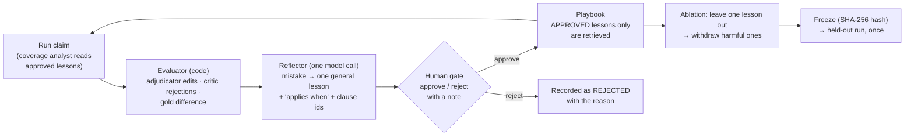

# Signature challenge B: a playbook that learns from adjudicators (Reflexion, L12)

*Report section owned by Dhruvi Ramani (Agents & Orchestration, Reflexion part). Code:
`src/claimsense/reflexion/` (harness started as Spandan Basu's boilerplate), the two scripts under
`scripts/run_reflexion_*.py`, outputs in `docs/experiments/reflexion/`. Every number here is copied
from a `report.md` in that folder; nothing is estimated. Items marked PENDING have not been run yet.*

## 1. What Reflexion is, in plain words

A new claims clerk keeps a notebook. Each time a senior corrects one of their decisions, they write
one line: *what to check next time, and when that check applies.* The manager reads every line and
either approves it or crosses it out with a reason. Before the next claim, the clerk reads only the
approved lines that are relevant to it. Now and then a line turns out to make decisions worse, so
the manager withdraws it. Before the final exam the notebook is locked and fingerprinted, so nobody
can say it changed during the exam.

In ClaimSense:

| Notebook word | ClaimSense word | What it is |
|---|---|---|
| the clerk | coverage analyst (`agents/coverage.py`) | the agent that picks one policy clause per bill line |
| a correction | a **mistake** (`reflexion/evaluator.py`) | an adjudicator edit, a critic rejection, or a difference from the gold worksheet |
| writing the line | **reflection** (`reflexion/reflector.py`) | one model call that turns a mistake into a short, general lesson |
| the line | a **lesson** | text, *applies when*, clause ids, source case, status, reviewer, review note |
| the manager | the **human gate** (`reflexion/review_cli.py`) | a named person types `y` or `n` at the terminal; `n` needs a reason |
| the notebook | the **playbook** (`reflexion/playbook.py`, data in `run-XX/playbook.json`) | all lessons with their status; only APPROVED ones are ever read by the analyst |
| crossing out later | **withdrawal** | status WITHDRAWN with a note; found by ablation |
| locking | **freeze** | SHA-256 of the approved lessons; the held-out script refuses anything else |
| the exam | the **held-out run** | 60 claims outside the repo, run once by the Evaluation owner |

The playbook never touches money. A lesson can only change *which clause* the analyst cites, from
clauses the policy search already returned; every rupee still comes from the calculator and a human
still approves every settlement (project rule 1 and rule 3 hold inside the loop).

### 1.1 How this differs from the adjudicator and senior approval in the graph

Two different human gates approve two different things:

| | Approval gate in the graph (L14) | Reflexion human gate (L12) |
|---|---|---|
| when | live, while one claim is being processed | after a batch of development claims, offline |
| what the person sees | one worksheet for one claim | one proposed lesson |
| decision | approve, edit a line, or reject the worksheet | approve or reject the lesson, with a reason |
| effect | that claim's settlement; an edit recalculates and kills the old approval | whether the lesson is shown to the analyst on *future* claims |
| who | the adjudicator, plus a senior above a threshold | a named reviewer (for `run-01`, Dhruvi Ramani) |

Reflexion sits *downstream* of the graph's approval gate: the edits the adjudicator makes there are
the first of its three feedback sources. The brief states the hand-off in one sentence (page 10,
step 9): "Adjudicator corrections become candidate lessons, used only after review." One gate fixes
*this* claim; the other makes sure the *next* claim does not need the same fix.

### 1.2 Where the playbook lives and what a lesson looks like

`run-01/playbook.json` is the playbook of the reviewed run. It has two keys: `frozen_hash` and
`lessons`. One lesson from it, exactly as stored:

```json
{
  "lesson_id": "LSN-47e092b0",
  "text": "Check if room or ICU rates exceed policy limits and apply proportional deduction to all expenses except medicines as per clause 4.1.1 Note b.",
  "applies_when": "When adjudicating medicine bill lines under the Arogya Sanjeevani policy with room or ICU rates exceeding limits.",
  "clause_ids": ["new_india_arogya_sanjeevani:4.1.1"],
  "source_case_id": "CLM-0004",
  "status": "approved",
  "reviewer_id": "Dhruvi Ramani",
  "review_note": null
}
```

`status` moves PROPOSED → APPROVED or REJECTED → WITHDRAWN; nothing is ever deleted. When the
coverage analyst runs, `Playbook.retrieve()` returns at most three APPROVED lessons that share a
clause id or wording with the claim, and `CoverageAgent.lessons_for()` appends them to the prompt
under "PLAYBOOK LESSONS". A lesson that quotes an amount, a name or a claim id is blocked before it
is even proposed (`reflector.too_specific`).

## 2. The loop



| Role in the loop | Code | What it does |
|---|---|---|
| actor | `graph/` + `agents/coverage.py` | the whole pipeline; `CoverageAgent.lessons_for()` adds up to 3 approved, relevant lessons to the prompt |
| evaluator | `reflexion/evaluator.py` | code only: adjudicator edits, critic rejections, difference from the gold worksheet; rounding tolerance |
| reflector | `reflexion/reflector.py` | one structured model call per mistake; blocks lessons that quote amounts or ids |
| memory | `reflexion/playbook.py` | PROPOSED → APPROVED / REJECTED → WITHDRAWN; retrieval by shared clause or wording; `freeze()` |
| experiment | `reflexion/loop.py`, `scripts/run_reflexion_experiment.py` | baseline → learn → ablate → withdraw → after ×2 → freeze → report |
| held-out | `reflexion/loop.run_heldout`, `scripts/run_reflexion_heldout.py` | refuses an unfrozen, changed or leaky playbook, and any path inside the repo |
| data | `reflexion/cases.py` | maps `eval/golden_dev/` into `DevCase` objects; raises on anything unmapped; lists the known gold-vs-calculator disagreements |

## 3. Method

- **Development claims only.** `learn()` asserts `split == "dev"`, and the day-4 script refuses any
  path that mentions the held-out set. The 60 held-out claims live outside the repository and are
  run once by the Evaluation owner with everything frozen.
- **What is scored.** Settlement error in rupees is `|first worksheet shown to the adjudicator − gold|`.
  The adjudicator's own corrections are not credited to the system. Exact-match rate is the share
  of claims with zero error (or within the tolerance, below). Edit rate is the share of claims
  where the adjudicator changed anything.
- **Rounding tolerance.** The development gold is whole rupees, the calculator keeps paise, so a
  correctly cut line can differ by up to Rs 0.50. `--tolerance-rs 1` makes a line within Rs 1 of
  the gold count as agreeing: no edit, no mistake, no lesson for it. Rupee error is still reported
  exactly. `run-01` was scored strictly (tolerance 0); `run-02` uses Rs 1. The value used is
  printed in every banner and stored in every result file.
- **The human gate.** Every lesson is shown to a named reviewer at the terminal, who approves or
  rejects it with a reason. An auto-approve switch exists only to test the harness and stamps the
  report "HARNESS CHECK ONLY".
- **Ablation.** Each approved lesson is removed in turn and the development set is re-run. A lesson
  is harmful if removing it lowers error or edit rate; harmful lessons are withdrawn with a note
  and stay visible in the playbook file.
- **Repeats.** The after pass is run twice and both runs are reported, because 20 claims is a small
  set.
- **Freeze.** The SHA-256 of the approved lessons is recorded; the held-out script checks it.

## 4. Results

### 4.1 Harness check, stub mode (rerun 7 November 2026 on the current gold) — proof the loop runs, not a result

Deterministic stub model, reference calculator, tolerance Rs 1, lessons auto-approved. File:
`docs/experiments/reflexion/harness-check-stub/report.md`. Gold as corrected by the 4 Nov 2026 audit.

| metric | before | after run 1 | after run 2 |
|---|---|---|---|
| settlement_error_total_rs | 186368.94 | 186368.94 | 186368.94 |
| settlement_error_mean_rs | 9318.45 | 9318.45 | 9318.45 |
| exact_match_rate | 0.5 | 0.5 | 0.5 |
| edit_rate | 0.3 | 0.3 | 0.3 |
| critic_rejection_rate | 0.0 | 0.0 | 0.0 |

Where the baseline error comes from: 6 cases exact, 4 within Rs 1 (rounding, counted as matches
under the tolerance), 10 with a real difference. All 10 are disagreements between the demo-rule
gold and the calculator (section 7), so no lesson can move them. Six template lessons were
proposed, none harmful, none helpful. Learn, dedupe, ablate, withdraw, freeze and hash check all
executed. Frozen hash `b10b6eb1…`.

The 1 Nov 2026 stub check on the pre-audit gold gave Rs 65,989.27 / exact 0.3 / edit 0.2, the same
table as the reviewed run below; the two new misses are CLM-0018 (now excluded in the gold) and
CLM-0016 (ICU line re-filed), explained in section 7.

### 4.2 Reviewed run, real model (`run-01`, 1 November 2026, pre-audit gold, strict scoring)

Real model via OpenRouter (`openai/gpt-4.1-mini` for every agent and for the reflector; the
reflector's default `openai/gpt-4.1` is not on the course key's allowed list, so it was overridden
with `CLAIMSENSE_MODEL_REFLECTOR`). Reference calculator. Reviewer: Dhruvi Ramani, deciding each
lesson at the terminal. Files: `docs/experiments/reflexion/run-01/`.

| metric | before | after run 1 | after run 2 |
|---|---|---|---|
| settlement_error_total_rs | 65989.27 | 65989.27 | 65989.27 |
| settlement_error_mean_rs | 3299.46 | 3299.46 | 3299.46 |
| exact_match_rate | 0.3 | 0.3 | 0.3 |
| edit_rate | 0.2 | 0.2 | 0.2 |
| critic_rejection_rate | 0.0 | 0.0 | 0.0 |

The real-model baseline equals the stub baseline to the paisa: the coverage model chose the same
clauses as the deterministic stub on all 20 claims, so none of the remaining error is a
clause-selection mistake. The same baseline run through the LangGraph executor
(`langgraph-check/`) gives the same numbers.

**Lessons: 14 proposed, 2 approved, 12 rejected, 0 withdrawn.** Frozen playbook hash
`6b4c530d988ac0615a32c258af3968d54475de1bc0dcce98edb2e20de14559b7`. Every lesson, as stored in
`run-01/playbook.json`:

| Lesson | From | Clauses cited | Lesson text (shortened) | Decision | Reviewer's reason |
|---|---|---|---|---|---|
| LSN-47e092b0 | CLM-0004 | 4.1.1 | Check if room or ICU rates exceed policy limits and apply proportional deduction to all expenses except medicines as per clause 4.1.1 Note b | **approved** | restates Note b correctly, incl. the medicines exception |
| LSN-3e9c456b | CLM-0012 | 4.1.1 | When the room or ICU rate exceeds the limits, apply proportional deduction to all expenses except medicines (nursing and room lines) | **approved** | same rule, stated for nursing/room lines |
| LSN-30d9c04f | CLM-0004 | 4.1 | Procedure lines are adjudicated under 4.1, not its sub-clauses like 4.1.1 | rejected | contradicts Note b: procedure charges are "other expenses" and are cut; gold reading not agreed with domain lead |
| LSN-1b0890dc | CLM-0011 | 4.1 | same as above | rejected | same reason |
| LSN-2a7a2cf8 | CLM-0012 | 4.1 | same as above | rejected | same reason |
| LSN-48602e95 | CLM-0014 | 4.1 | same as above | rejected | same reason |
| LSN-e90ad757 | CLM-0004 | 4.1.1 | Apply the proportional deduction without rounding amounts prematurely | rejected | rounding is the calculator's, not a clause choice; the gold rounds to whole rupees |
| LSN-d69e9593 | CLM-0011 | 4.1.1 | same as above | rejected | same reason |
| LSN-99d83f2a | CLM-0005 | (invented id) | Always confirm coverage applicability for the investigations category | rejected | vague, cites a clause id that does not exist; the mistake was an in-bill duplicate line, a fraud finding |
| LSN-aadc9136 | CLM-0009 | (invented id) | same as above | rejected | same reason |
| LSN-ad720734 | CLM-0010 | none | same as above | rejected | same reason |
| LSN-dd440297 | CLM-0015 | (invented id) | same as above | rejected | same reason |
| LSN-e42ab612 | CLM-0014 | 4.1.1 | Check proportional deduction rules under 4.1.1 when room or ICU rates exceed limits (medicine lines) | rejected | omits the medicines exception; could nudge towards cutting medicines; the approved lesson states it |
| LSN-9b81c322 | CLM-0014 | 4.1.1 | Other expenses except medicines are proportionally reduced per Note b (nursing lines) | rejected | correct but a duplicate of an approved lesson; keeps the playbook small |

Ablation: removing either approved lesson changed no amount and no edit (expected: both restate
what the calculator already does). Nothing withdrawn.

**Reading of the result.** Before equals after because the loop had nothing legitimate to learn
on this set: the 8 real misses come from the gold's demo rules disagreeing with the policy
wording, and the human gate refused the 12 lessons that would have taught the system to follow
the gold against the wording. That refusal is the mechanism working, not failing: an unreviewed
loop would have approved "do not cut the procedure line" four times and moved the system away from
the policy text. A measurable improvement needs development cases where the clause choice decides
the amount (section 8).

### 4.3 Reviewed run on the corrected gold (`run-02`, 7 November 2026, tolerance Rs 1) — the current result

Same setup as `run-01` (`openai/gpt-4.1-mini` for every agent and the reflector, reference
calculator, reviewer Dhruvi Ramani at the terminal) on the gold as corrected by the 4 Nov 2026 audit,
scored with `--tolerance-rs 1`. Files: `docs/experiments/reflexion/run-02/`.

| metric | before | after run 1 | after run 2 |
|---|---|---|---|
| settlement_error_total_rs | 186368.94 | 186368.94 | 186368.94 |
| settlement_error_mean_rs | 9318.45 | 9318.45 | 9318.45 |
| exact_match_rate | 0.5 | 0.5 | 0.5 |
| edit_rate | 0.3 | 0.3 | 0.3 |
| critic_rejection_rate | 0.0 | 0.0 | 0.0 |

The real-model baseline again equals the stub baseline to the paisa (section 4.1). 6 cases exact,
4 within Rs 1 (counted as matches under the tolerance), 10 real misses, all of them the five
disagreements in section 7.

**Lessons: 19 proposed, 1 approved, 18 rejected, 0 withdrawn.** Frozen playbook hash
`b566637830ffd4f5204d56d4a894ae83693ef6cdce40f153c1eaa9a7ce3f8e25`. Every lesson, as stored in
`run-02/playbook.json`:

| Lesson | From | Clauses cited | Lesson text (shortened) | Decision | Reviewer's reason |
|---|---|---|---|---|---|
| LSN-94d962cc | CLM-0012 | 4.1.1 | Check if room or ICU rates exceed policy limits and apply proportional deduction to all expenses except medicines as per clause 4.1.1 Note b | **approved** | restates Note b correctly, including the medicines exception |
| LSN-f5250306 | CLM-0004 | 4.1 | Procedure claims are adjudicated under 4.1, not its sub-clauses like 4.1.1 | rejected | contradicts clause 4.1.1 Note b; encodes the gold demo rule |
| LSN-68244324 | CLM-0011 | 4.1 | same | rejected | same reason |
| LSN-ce8639a3 | CLM-0012 | 4.1 | same | rejected | same reason |
| LSN-e0679e78 | CLM-0014 | 4.1 | same | rejected | same reason |
| LSN-2e7f10fb | CLM-0004 | 4.1.1 | Check for proportional deduction rules under 4.1.1 when room or ICU rates exceed limits (medicine bills) | rejected | omits the medicines exception in clause 4.1.1 Note b |
| LSN-b6b2fc66 | CLM-0011 | 4.1.1 | same | rejected | same reason |
| LSN-e4fcd015 | CLM-0005 | (invented id) | Check the coverage applicability for the investigations category | rejected | vague, cites a non-existent clause id; duplicate line is a fraud finding, not a clause choice |
| LSN-bac41516 | CLM-0009 | (invented id) | same | rejected | same reason |
| LSN-31e1e0e0 | CLM-0010 | (invented id) | same | rejected | same reason |
| LSN-f53d8fe9 | CLM-0015 | (invented id) | Confirm that the investigations category is excluded from coverage | rejected | false: investigations are covered under 4.1; invented clause id; duplicate line is a fraud finding |
| LSN-7e83a7ff | CLM-0016 | 4.1 | For nursing claims apply 4.1 rather than sub-clauses like 4.1.1 | rejected | ICU-breach proportional cut awaits a domain ruling; lesson encodes the gold's no-cut reading |
| LSN-ec7bd6d7 | CLM-0016 | 4.1 | For investigations apply 4.1 rather than sub-clauses like 4.1.1 | rejected | same reason |
| LSN-c3b3ef85 | CLM-0018 | 7.15 | For procedure claims verify that clause 7.15 is applied | rejected | *recorded reason is the ICU one above, pasted by mistake at the terminal; the intended reason is the admissibility one below. The playbook is frozen, so the stored note is left as it is.* |
| LSN-944d94bf | CLM-0018 | 7.15 | For room claims apply clause 7.15 as the governing clause | rejected | admissibility is deterministic code, not a clause choice; exclusion check is AGT-02 |
| LSN-7397efdb | CLM-0018 | 7.15 | For nursing claims always apply clause 7.15 | rejected | same reason |
| LSN-67834e9d | CLM-0018 | 7.15 | For medicines claims always apply clause 7.15 | rejected | same reason |
| LSN-5e17eac9 | CLM-0018 | 7.15 | For investigations claims always apply clause 7.15 | rejected | same reason |
| LSN-e338d6c8 | CLM-0018 | (invented id) | Verify claim admissibility criteria before approving any claim | rejected | vague, applies to everything, invented clause id; admissibility is deterministic code |

Ablation: removing the one approved lesson changed no amount and no edit. Nothing withdrawn.

**What changed against `run-01`.** The rounding tolerance removed the two "do not round
prematurely" lessons: no lesson about rounding was proposed. The corrected gold added seven new
proposals from CLM-0016 and CLM-0018, all rejected, because neither case is a clause-selection
problem: one waits for a domain ruling on the ICU-breach cut and the other needs an exclusion rule
in the admissibility code. The 7.15 lessons show the reflector's limit clearly: it tried to turn
"this claim should have been excluded" into "cite clause 7.15 on every line", which the gate
refused.

**Reading of the result.** Before equals after for the same reason as in `run-01`: every remaining
miss is a disagreement between the gold and the calculator or a missing deterministic check, and
none of them is a clause the coverage analyst could have chosen differently. The loop's value on
this set is the 18 refusals, each with a written reason, which is what the brief asks the human gate
to provide. A measurable improvement needs development cases where the clause choice decides the
amount (section 8).

### 4.4 Held-out, 60 claims — PENDING

Run once by the Evaluation owner with `scripts/run_reflexion_heldout.py` against the frozen
`run-02` playbook; before/after table and the spread over 3 repeats to be pasted from its
`heldout_report.md`.

## 5. Design decisions

1. **Lessons are code-reviewed memory.** Proposed, then approved or rejected with a note, then
   retrievable, then withdrawable. A lesson never reaches a prompt without a named person's
   approval, so the playbook cannot drift on its own.
2. **The evaluator is code.** "Does the first worksheet match the gold" is a `Decimal` comparison.
   Scoring it with a model would add noise to the one signal the loop depends on.
3. **One lesson per mistake, general, with a precondition.** The reflector must state when the
   lesson applies, and lessons quoting amounts, names or ids are blocked. "Kabir's dinner was
   Rs 7,500" helps nobody; "check the policy year before applying a sub-limit (clause X)" does.
4. **Retrieve few, relevant lessons.** At most three, sharing a clause or wording with the claim.
   A cataract lesson never reaches a room-rent claim, and the prompt does not fill with noise.
5. **Settlement error is scored on the first worksheet the adjudicator sees.** Otherwise the
   human's corrections would be credited to the system.
6. **Ablation finds harmful lessons; withdrawal is a status, not a delete.** The brief asks us to
   identify lessons that made results worse. Two improvements and one regression look like net
   progress in an aggregate; leave-one-out does not let that hide, and the withdrawn lesson stays
   in the file as evidence.
7. **Freeze before held-out, with a hash.** Without it the held-out result measures a moving target.
   The held-out script refuses an unfrozen playbook, a changed one, or one holding a lesson learned
   from a held-out case.
8. **Nothing in the loop changes an amount.** Lessons steer clause choice; the calculator decides
   the rupees; a human approves the settlement.
9. **Rounding tolerance in the evaluator, not in the gold.** Changing the gold would change every
   owner's scores; a tolerance in this part's evaluator affects only what Reflexion treats as a
   mistake, is visible in every banner and file, and defaults to strict.
10. **Unknown gold codes fail loudly.** When the 4 Nov gold audit added a reason code, `load_cases()`
    raised instead of guessing; the fix was a one-line mapping plus a test, and nothing was scored
    wrongly in between.

## 6. What the brief asks for, and where it is

Capstone guide page 10, signature challenge B and the L12 row of "What you build":

| The brief says | Where it is done | Evidence |
|---|---|---|
| Run a Reflexion loop on development claims | `loop.learn()` asserts the dev split; the day-4 script refuses held-out paths | `tests/orchestration/test_cases.py::test_day4_experiment_script_runs_end_to_end_and_freezes` |
| … using adjudicator edits and critic rejections as feedback | `evaluator.mistakes_from_run()` sources `adjudicator_edit`, `critic_rejection` (plus `gold_diff`) | section 2 table |
| A reflection step turns each mistake into a short lesson naming its clause and when it applies | `reflector.reflect()` → `LessonDraft(lesson, applies_when, clause_ids)` | lesson table in 4.2 |
| An adjudicator approves each lesson before it enters the playbook | `review_cli.console_approver()`; only APPROVED lessons are retrieved | 14 decisions with reasons in `run-01/playbook.json` |
| The coverage analyst retrieves only relevant lessons | `Playbook.retrieve()` by shared clause id or wording, at most 3 | `test_reflexion.py::test_only_approved_lessons_are_retrieved` |
| Any lesson can be withdrawn | `Playbook.withdraw()`, `review_cli withdraw`, automatic after ablation | `test_reflexion.py::test_ablation_finds_and_withdraws_a_harmful_lesson` |
| Measure settlement error and adjudicator edit rate before and after | `metrics.summarize()`, `compare_table()`; after pass run twice | tables in section 4 |
| Identify lessons that made results worse | `loop.ablate()` leave-one-out; "Lessons that made results worse" in every `report.md` | 4.2: none in `run-01` |
| L12: run the loop on development claims, then freeze it before the held-out run | `Playbook.freeze()` SHA-256; `run_heldout()` refuses an unfrozen or changed playbook | `test_reflexion.py::test_heldout_refuses_unfrozen_or_leaky_playbook` |
| Step 9: adjudicator corrections become candidate lessons, used only after review | status flow PROPOSED → APPROVED; PROPOSED lessons are never retrieved | section 1.2 |

The evaluation owner's metrics for the whole system (`eval/`) are separate from these; this section
reports only the two the brief names for challenge B, settlement error and edit rate, plus
exact-match and critic-rejection rates for context.

## 7. Where the gold and the calculator disagree (decisions from the lead's walkthrough)

Each of these shows up as a baseline miss that no lesson can remove. They are listed in code in
`cases.RULE_DISAGREEMENTS` and printed in every report.

| # | Disagreement | Claims | Decision |
|---|---|---|---|
| 1 | Gold applies the room-rent proportional cut to pharmacy lines and not to the procedure line; the calculator exempts medicines and cuts procedure, following clause 4.1.1 Note (b) | CLM-0004, 0011, 0012, 0014 | **Gold not relabelled now** (lead): a relabel changes every owner's scores. Mapping unchanged; gap reported. |
| 2 | Gold deducts an in-bill duplicate line in full; the fraud agent only flags duplicates and a flag never changes an amount | CLM-0005, 0009, 0010, 0015 | **Stays a fraud flag for the human** (lead); no clause pays it at zero. |
| 3 | Gold is whole rupees, the calculator keeps paise; cut lines differ by up to Rs 0.50 | 4 to 6 claims depending on the gold version | **Tolerance in the Reflexion evaluator** (`--tolerance-rs 1`), gold unchanged (lead). Done. |
| 4 | Gold (4 Nov audit, GOLD-01) excludes CLM-0018, a caesarean, under clause 7.15; the admissibility check has no exclusion rule yet (AGT-02) | CLM-0018 | Orchestration owner's item; a known baseline miss until then. |
| 5 | Gold (4 Nov audit, GOLD-04) caps CLM-0016's ICU day but applies no proportional cut because the room rent is within its cap; the calculator applies Note (b) to an ICU breach as well | CLM-0016 | Open: needs a domain ruling on whether Note (b) follows an ICU breach. |

## 8. Limitations and open items

- **Headroom.** With the reference calculator a clause choice changes an amount only when it is a
  non-payable or waiting-period clause, and the pipeline already gets those right on this set.
  A measurable before/after needs development cases where the clause choice decides the money
  (consumables vs medicines, cataract sub-limit, waiting-period edges), or the real model making a
  mistake the stub does not make.
- **Stub lessons are templates.** In stub mode the reflector writes "for X lines, check clause A
  before clause B"; the stub analyst applies them crudely. Only the real-model run produces lessons
  worth reading.
- **Team calculator.** `calc/adjudication.py` now exists; the runner's `--calculator team` switch
  goes through `agents.services.real_calculate` and has not yet been used for a reported run.
- **Placeholder clause ids.** `agents/clauses.py` still has four TODO ids (waiting periods,
  non-payable items); lessons quote ids verbatim.
- **Small set.** 20 development claims, of which 7 are not admissible in the current gold, leaves 13
  payable claims to learn from. Both after runs are reported for that reason.
- **Held-out is pending.** `run-02` is the current reviewed run (corrected gold, tolerance Rs 1);
  `run-01` is kept as the strict-scoring run on the pre-audit gold.
