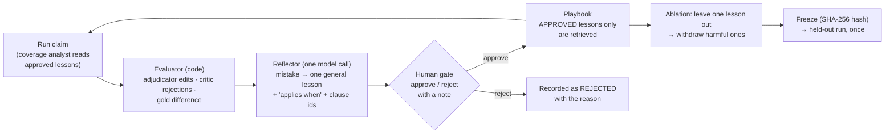

# Signature challenge B: a playbook that learns from adjudicators (Reflexion, L12)

*Report section owned by Dhruvi Ramani (Agents & Orchestration, Reflexion). Harness code by
Spandan Basu (`src/claimsense/reflexion/`). Numbers marked PENDING are filled from
`docs/experiments/reflexion/run-01/report.md` after the reviewed run; nothing here is estimated.*

## 1. What the playbook is

When the coverage analyst picks the wrong clause for a bill line, a human adjudicator corrects it.
Reflexion turns each correction into a short written lesson, has a person approve or reject the
lesson, and lets the coverage analyst read approved, relevant lessons before choosing clauses on the
next claim. The brief calls this "code-reviewed memory": a lesson is proposed, reviewed, used,
and can be withdrawn, like a code change.

The playbook never touches money. Lessons only influence *which clause* the analyst cites; every
rupee still comes from the calculator.

## 2. The loop

| Role in the loop | Code | What it does |
|---|---|---|
| actor | `graph/` + `agents/coverage.py` | the whole pipeline; `CoverageAgent.lessons_for()` adds up to 3 approved, relevant lessons to the prompt |
| evaluator | `reflexion/evaluator.py` | code only: adjudicator edits, critic rejections, difference from the gold worksheet |
| reflector | `reflexion/reflector.py` | one structured model call per mistake; blocks lessons that quote amounts or ids |
| memory | `reflexion/playbook.py` | PROPOSED → APPROVED / REJECTED → WITHDRAWN; retrieval by shared clause or wording; `freeze()` |
| experiment | `reflexion/loop.py`, `scripts/run_reflexion_experiment.py` | baseline → learn → ablate → withdraw → after ×2 → freeze → report |
| held-out | `reflexion/loop.run_heldout`, `scripts/run_reflexion_heldout.py` | refuses an unfrozen, changed or leaky playbook |
| data | `reflexion/cases.py` | maps `eval/golden_dev/` into `DevCase` objects; raises on anything unmapped |

## 3. Method

- **Development claims only.** `learn()` asserts `split == "dev"`. The 60 held-out claims live outside
  the repository and are run once by the Evaluation owner with everything frozen.
- **What is scored.** Settlement error in rupees is `|first worksheet shown to the adjudicator − gold|`.
  The adjudicator's own corrections are not credited to the system. Edit rate is the share of
  claims where the adjudicator changed anything.
- **The human gate.** Every lesson is shown to a named reviewer at the terminal, who approves or
  rejects it with a reason. An auto-approve switch exists only to test the harness and stamps the
  report "HARNESS CHECK ONLY".
- **Ablation.** Each approved lesson is removed in turn and the development set is re-run. A lesson
  is harmful if removing it lowers error or edit rate; harmful lessons are withdrawn with a note
  and stay visible in the playbook file.
- **Repeats.** The after pass is run twice and both runs are reported, because 20 claims is a small
  set.
- **Freeze.** The SHA-256 of the approved lessons is recorded; the held-out script checks it.

## 4. Results

### 4.1 Harness check, stub mode (1 November 2026) — not a result, proof the loop runs

Deterministic stub model, reference calculator, lessons auto-approved. File:
`docs/experiments/reflexion/harness-check-stub/report.md`.

| metric | before | after |
|---|---|---|
| settlement_error_total_rs | 65989.27 | 65989.27 |
| settlement_error_mean_rs | 3299.46 | 3299.46 |
| exact_match_rate | 0.3 | 0.3 |
| edit_rate | 0.2 | 0.2 |
| critic_rejection_rate | 0.0 | 0.0 |

Where the baseline error comes from: 6 cases exact, 6 cases within Rs 1 (rounding), 8 cases with a
real difference. All 8 are disagreements between the demo-rule gold and the calculator (section 6),
so no lesson can move them. Three lessons were proposed (duplicates merged), none harmful, none
helpful. The learn, dedupe, ablate, withdraw, freeze and hash-check steps all executed.

### 4.2 Reviewed run, real model (1 November 2026)

Real model via OpenRouter (`openai/gpt-4.1-mini` for every agent and for the reflector; the
reflector's default `openai/gpt-4.1` is not on the course key's allowed list, so it was overridden
with `CLAIMSENSE_MODEL_REFLECTOR`). Reference calculator. Reviewer: Dhruvi Ramani, deciding each
lesson at the terminal. Files: `docs/experiments/reflexion/run-01/`.

| metric | before | after run 1 | after run 2 |
|---|---|---|---|
| settlement_error_total_rs | 65989.27 | 65989.27 | 65989.27 |
| settlement_error_mean_rs | 3299.46 | 3299.46 | 3299.46 |
| exact_match_rate | 0.3 | 0.3 | 0.3 |
| edit_rate | 0.2 | 0.2 | 0.2 |
| critic_rejection_rate | 0.0 | 0.0 | 0.0 |

The real-model baseline equals the stub baseline to the paisa: the coverage model chose the same
clauses as the deterministic stub on all 20 claims, so none of the remaining error is a
clause-selection mistake.

**Lessons: 14 proposed, 2 approved, 12 rejected, 0 withdrawn.** Frozen playbook hash
`6b4c530d988ac0615a32c258af3968d54475de1bc0dcce98edb2e20de14559b7`.

Approved (both restate clause 4.1.1 Note b correctly):
- LSN-47e092b0: "Check if room or ICU rates exceed policy limits and apply proportional deduction
  to all expenses except medicines as per clause 4.1.1 Note b."
- LSN-3e9c456b: "When the room or ICU rate exceeds the policy limits, apply proportional deduction
  to all expenses except medicines as specified in clause 4.1.1 Note b." (nursing and room lines)

Rejected, by reason:
- 4 lessons saying procedure lines are adjudicated under 4.1 and not its sub-clauses. Reason: they
  encode the gold file's "procedure is not cut" rule, but clause 4.1.1 Note b cuts *all other
  expenses except medicines*; the reading is not agreed with the domain lead.
- 2 lessons about not rounding amounts prematurely. Reason: rounding is the calculator's, not a
  clause choice; the difference is the gold file rounding to whole rupees.
- 4 lessons from the duplicate-bill cases ("always confirm coverage applicability for
  investigations"). Reason: vague, and they cite a clause id that does not exist (or none); an
  in-bill duplicate is a fraud finding, not a clause question.
- 1 lesson pointing medicine lines at the proportional cut without the medicines exception.
  Reason: could nudge towards cutting medicines; the approved lesson states the exception.
- 1 correct lesson rejected as a duplicate of an approved one, to keep the playbook small.

Ablation: neither approved lesson changed any amount or edit (expected: both restate what the
calculator already does). Nothing withdrawn.

**Reading of the result.** Before equals after because the loop had nothing legitimate to learn
on this set: the 8 real misses come from the gold's demo rules disagreeing with the policy
wording, and the human gate refused the 12 lessons that would have taught the system to follow
the gold against the wording. That refusal is the mechanism working, not failing. A measurable
improvement needs either a relabelled gold or development cases where the clause choice decides
the amount (section 6).

### 4.3 Held-out, 60 claims — PENDING

Run once by the Evaluation owner with `scripts/run_reflexion_heldout.py`; before/after table and
the spread over 3 repeats to be pasted from its `heldout_report.md`.

## 5. Design decisions

1. **Lessons are code-reviewed memory.** Proposed, then approved or rejected with a note, then
   retrievable, then withdrawable. A lesson never reaches a prompt without a named person's
   approval, so the playbook cannot drift on its own.
2. **The evaluator is code.** "Does the first worksheet match the gold" is a `Decimal` comparison.
   Scoring it with a model would add noise to the one signal the loop depends on.
3. **One lesson per mistake, general, with a precondition.** The reflector must state when the
   lesson applies, and lessons quoting amounts, names or ids are blocked. "Kabir's dinner was
   Rs 7,500" helps nobody; "check the policy year before applying a sub-limit (clause X)" does.
4. **Retrieve few, relevant lessons.** At most three, sharing a clause or wording with the claim.
   A cataract lesson never reaches a room-rent claim, and the prompt does not fill with noise.
5. **Settlement error is scored on the first worksheet the adjudicator sees.** Otherwise the
   human's corrections would be credited to the system.
6. **Ablation finds harmful lessons; withdrawal is a status, not a delete.** The brief asks us to
   identify lessons that made results worse. Two improvements and one regression look like net
   progress in an aggregate; leave-one-out does not let that hide, and the withdrawn lesson stays
   in the file as evidence.
7. **Freeze before held-out, with a hash.** Without it the held-out result measures a moving target.
   The held-out script refuses an unfrozen playbook, a changed one, or one holding a lesson learned
   from a held-out case.
8. **Nothing in the loop changes an amount.** Lessons steer clause choice; the calculator decides
   the rupees; a human approves the settlement. Rule 1 of the project holds inside the learning loop.

## 6. Limitations and open items

- **Gold vs calculator rule disagreements** (all visible in the baseline, none fixable by a lesson):
  gold applies the room-rent proportional cut to pharmacy and not to the procedure line, the
  reference calculator does the opposite (clause 4.1.1 Note b exempts medicines); gold zeroes an
  in-bill duplicate line, while the fraud agent only checks claim history and a flag never changes
  an amount; gold is whole rupees and the calculator is paise, so cut lines differ by up to Rs 0.50
  and count as edits. Decision owners: domain lead (rules), Spandan (evaluator tolerance).
- **Headroom.** With the reference calculator a clause choice changes an amount only when it is a
  non-payable or waiting-period clause, and the pipeline already gets those right on this set.
  A measurable before/after needs development cases where the clause choice decides the money
  (consumables vs medicines, cataract sub-limit, waiting-period edges), or the real model showing
  a mistake the stub does not make.
- **Stub lessons are templates.** In stub mode the reflector writes "for X lines, check clause A
  before clause B"; the stub analyst applies them crudely. Only the real-model run produces lessons
  worth reading.
- **Reference calculator.** The team calculator (`calc/adjudication.py`, T15) is not implemented
  yet; the runner has a `--calculator team` switch ready for it.
- **Placeholder clause ids.** `agents/clauses.py` still has four TODO ids (waiting periods,
  non-payable items); lessons quote ids verbatim, so these should be filled before the reviewed run.
- **Small set.** 20 development claims, of which 6 are not admissible, leaves 14 payable claims to
  learn from. Both after runs are reported for that reason.
