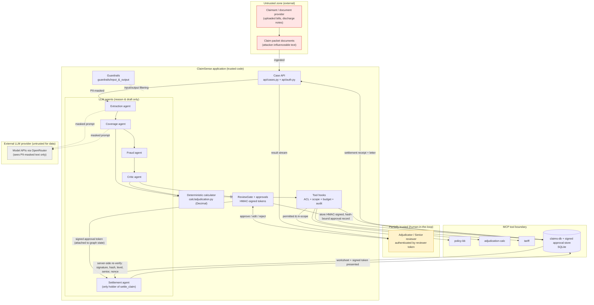

# ClaimSense Threat Model

**System:** ClaimSense — AI-assisted health-insurance claim adjudication
**Document type:** Security architecture and threat model (capstone submission)
**Scope:** Local repository `ClaimSense-Insurance/` as inspected for this document
**Status of controls:** Every control below is labelled with one of:
*Implemented and verified* · *Implemented but insufficiently tested* · *Partially implemented* · *Recommended / not implemented* · *Unable to verify*

> This is a documentation artifact. No application code, test, contract, ADR or configuration was changed to produce it. Claims are grounded in specific files, classes and functions in the repository, and in the tests that exercise them.

---

## A. Executive Summary

ClaimSense ingests a health-insurance claim packet (claim form plus supporting documents), extracts a structured claim, retrieves the applicable policy clauses, runs a team of LLM agents (extraction, coverage, fraud, critic, settlement) to produce a settlement worksheet, pauses for a human adjudicator to approve, and then writes a settlement or repudiation to a claims database with an audit trail. The orchestration is a LangGraph state machine (`src/claimsense/graph/`), the agents live in `src/claimsense/agents/`, the tools are exposed either in-process or over MCP (`src/claimsense/mcp_servers/`, `src/claimsense/agents/mcp_services.py`), and the money-moving decisions are guarded by signed human approvals (`src/claimsense/mcp_servers/approvals.py`).

Security matters here for three reasons. First, the system touches **sensitive health and policy data** (diagnoses, bills, policyholder identity). Second, it **moves money**: an unauthorized or manipulated settlement is a direct financial loss and a compliance failure. Third, it is **agentic**: LLMs read attacker-influenceable documents and drive tool calls, so prompt injection and excessive agency are first-class risks rather than hypothetical ones.

The design's central security idea is a **separation of authority**: the LLM agents reason and draft, but they do not decide payment. Money is protected by three independent locks that all live in code, not in a prompt:

1. **Per-agent least privilege** — only the settlement agent's tool belt contains `settle_claim` / `record_repudiation` (`agents/permissions.py`).
2. **Deterministic calculation** — every rupee is computed by `calc/adjudication.py` using `Decimal` arithmetic; the LLM never produces an amount.
3. **Signed human approval bound to the exact worksheet** — settlement verifies an HMAC-signed, nonce-carrying, single-use approval token whose hash matches the worksheet being paid (`mcp_servers/approvals.py`, `mcp_servers/claims_db.py`).

These locks protect **arithmetic integrity and authorization**, which is a narrower guarantee than *decision correctness*. The deterministic calculator guarantees the worksheet's numbers are internally consistent and that no agent-chosen amount can be injected, and the approval lock guarantees no payment moves without a signed human sign-off. They do **not** guarantee the decision is *right*: if a model selects the wrong clause or misreads policy wording — including under a successful prompt injection in an uploaded document — the pipeline can still produce a well-formed, fully reconciling, but substantively **incorrect** worksheet. The critic and the human review gate reduce this risk but do not eliminate it (see §H and T-05).

The strongest, best-tested parts of the system are the settlement/approval path and the least-privilege tool ACL. The most important remaining risks are operational: the shipped identity provider is demo-grade, approval-token **expiry and signature-forgery resistance are implemented but not directly tested**, and several defensive layers (grounding judge, LLM injection classifier, audit sink, per-tool budgets) are **off or unwired by default**.

---

## B. System Architecture and Data Flow

### B.1 Claim lifecycle (verified against `graph/nodes.py`)

The pipeline is a LangGraph graph whose nodes are methods of `Nodes` in `src/claimsense/graph/nodes.py`. The node order and routers are:

```
plan → extract → admissibility ─┬─ coverage → fraud → critic ─┬─ human_review ─┬─ settle → memory_update
                                │                 ▲ (fail, r<max)│               │ (senior needed)
                                │                 └── revise ◄────┤               ├─ senior_review → settle
                                │                                 └ escalate ─────┘
                                └─ (not admissible) → human_review → repudiate → memory_update
  human/senior "edit" → apply_edits → critic → human_review   (earlier approvals become void)
```

1. **Ingestion.** A claim packet enters via the Case API (`api/cases.py`, `POST /claims`) or the local runner. The packet carries `claim_id`, `documents` (name → text), and a `policy_number` read from the request body by intake, not from the documents (`graph/nodes.registered_policy` returns `packet["policy_number"]`). **Important distinction:** this policy number is *supplied at intake* and is trusted only *relative to* document-extracted text (which is attacker-influenceable); the repository does **not** independently verify that the policy belongs to the claimant. No claimant-to-policy ownership check exists in code, and in this codebase claims are started with *reviewer* tokens, so there is no authenticated claimant identity to bind a policy to. The security value of `registered_policy` is therefore **scope consistency** (tools act on the intake value, and an extracted mismatch is flagged), not **ownership proof** — see residual risk §L.8 and the recommendation in §J.
2. **Extraction.** `agents/extraction.py` turns documents into a typed `Claim` (`contracts/claim.py`). Document text is PII-masked before it reaches the model (`_extract` → `input_guardrails.mask_pii`) and each bill line must trace to a source span (`verify_spans`). Injection tripwires run here (`detect_injections`).
3. **Policy retrieval / admissibility.** `agents/coverage.py` checks admissibility and selects clauses, retrieving policy content from the policy knowledge base (`mcp_servers/policy_kb.py`) and policy records from the claims DB (`mcp_servers/claims_db.py`).
4. **Agent orchestration + tools.** Agents reach tools only through a `ToolBelt` (`agents/permissions.py`). With hooks enabled (`hooks/hooks.py`), each call is permission-checked, scope-checked, budget-charged and audited.
5. **Deterministic calculation.** `calc/adjudication.py::adjudicate` computes the `Worksheet` (`contracts/worksheet.py`) in `Decimal`. The worksheet self-validates that line and total arithmetic reconciles.
6. **Fraud + critic.** `agents/fraud.py` flags duplicates, used sub-limits, tariff outliers and date issues; `agents/critic.py` re-runs the calculator and checks every deduction cites a clause.
7. **Human approval.** `nodes._review` delegates to `approvals.ReviewGate`. On APPROVE it mints a signed token into the approval store. High-value or fraud-flagged claims additionally require a SENIOR approval.
8. **Settlement / repudiation + audit.** `agents/settlement.py` runs the payment and letter guards, then calls `settle_claim`/`record_repudiation`, which **independently re-verify** the signed approval server-side (`claims_db.ClaimsDatabase.settle_claim`). History is recorded in `memory_update`.

### B.2 Data-flow diagram with trust boundaries



**Trust boundaries (crossings where data changes trust level):**

| # | Boundary | Where in code | What crosses | Control at the crossing |
|---|----------|---------------|--------------|-------------------------|
| TB-1 | External documents → application | `api/cases.py`, `agents/extraction.py` | Attacker-controlled text | PII masking, injection tripwire, span verification |
| TB-2 | Application → LLM provider | `agents/llm.py` (`as_data`, `DATA_RULE`), `extraction._extract` | Prompt text | PII masked; document text wrapped as *data*, not instructions |
| TB-3 | Agent → tools | `agents/permissions.py`, `hooks/hooks.py` | Tool name + arguments | Per-agent ACL, claim/policy scope, budget, audit |
| TB-4 | Reasoning → money | `agents/settlement.py` → `claims_db.settle_claim` | Worksheet + approval tokens | Signed-approval verification server-side |
| TB-5 | Human → approval | `api/cases.py` `decide`, `approvals.ReviewGate` | Decision + identity | Reviewer token, level check, four-eyes, trusted identity |
| TB-6 | Application ↔ MCP servers | `agents/mcp_services.py` | JSON tool calls | Per-server env isolation, tool pinning at connect |

---

## C. Assets and Sensitive Information

| Asset | Where it lives | Confidentiality | Integrity | Availability |
|-------|----------------|-----------------|-----------|--------------|
| Patient / policyholder identity | Pseudonymized (`insured_pseudonym`, `patient_pseudonym`) in `contracts/claim.py`, `claims_db` policies table | High — but already pseudonymized by design | High — drives letter addressing | Medium |
| Medical records / diagnosis | Claim documents, `Claim.diagnosis`, bill lines | High | High — affects admissibility | Low |
| Hospital bills / supporting docs | Packet `documents`, `bill_lines` | High | **Critical** — amounts drive payout | Medium |
| Policy documents / clauses | `mcp_servers/policy_kb.py`, policies table | Medium | High — wrong clause = wrong decision | Medium |
| Settlement worksheet | `contracts/worksheet.py` | Medium | **Critical** — the object approval binds to | High |
| Claim amount / `total_payable` | `Worksheet.total_payable` | Medium | **Critical** | High |
| Approval tokens + records | `ApprovalToken` (`contracts/approval.py`), `ApprovalRecord` + stores (`approvals.py`) | High (nonce/signature) | **Critical** — forgery = unauthorized payment | High |
| Server approval secret | `CLAIMSENSE_APPROVAL_SECRET` (env) | **Critical** — HMAC key | Critical | High |
| Fraud indicators / risk flags | `fraud_flags` on worksheet & state | Medium | High — drive senior gate | Medium |
| Claim history / audit records | `claims` + `settlements` tables, audit sink (`api/audit.py`) | Medium | High — repudiation defence, non-repudiation | High |
| API / model credentials | `OPENROUTER_API_KEY`, Langfuse keys (`.env`) | **Critical** | High | High |

---

## D. Actors and Trust Boundaries

| Actor | Trust level | Rationale (from code) |
|-------|-------------|-----------------------|
| Claimant / document provider | **Untrusted** | Supplies documents that may carry injected instructions; never authenticated into the decision path. |
| ClaimSense application code | **Trusted** | The TCB: calculator, ACL, approval verification, guardrails all run here. |
| LLM agents (extraction/coverage/fraud/critic) | **Constrained / semi-trusted** | Trusted to reason, *not* to move money; bounded by ACL, scope, budget. Their output is treated as data, never as authorization. |
| Settlement agent | **Constrained** | Only holder of `settle_claim`, but still cannot pay without a valid signed approval verified by the DB. |
| LLM provider (OpenRouter-hosted models) | **Untrusted for data, relied-on for function** | Receives only PII-masked text; its output is validated/structured and never trusted as instructions. |
| MCP tool servers | **Trusted code, isolated process** | Each server gets only the env it needs (`mcp_services.SERVER_ENV`); pinned at connect. |
| Claims DB / approval store | **Trusted store** | Source of truth for settlements and signed approvals; enforces one-final-decision. |
| Human adjudicator / senior reviewer | **Partially trusted** | Authenticated by reviewer token; authority is bounded to their level and the four-eyes rule. |
| Settlement / downstream payment system | **Out of scope / assumed trusted** | Repository ends at `settle_claim` writing the settlements table; downstream disbursement is not in this codebase. |
| Malicious insider / external attacker | **Adversary** | Modelled throughout STRIDE below. |

---

## E. STRIDE Threat Analysis

### E.1 Spoofing
- **Approver impersonation.** A caller tries to approve as a different adjudicator or above its level. Mitigated: the review gate takes identity from the `IdentityProvider`, not the UI payload (`approvals.ReviewGate._authenticate`; `api/auth.ApiIdentityProvider` derives id+level from the bearer token, verified in `test_review_gate.test_identity_comes_from_the_provider_not_the_ui_reply`).
- **Agent identity spoofing to reach `settle_claim`.** A prompt-injected agent claims to be the settlement agent. Mitigated by the static `TOOL_ACL` keyed on `AgentName` and re-checked inside `ToolBelt.call`.
- **Document-asserted policy identity.** Injected text sets a different policy number to pull another policy's data. Partially mitigated: tool scope is pinned to the intake-supplied `registered_policy`, not to extracted text, and extraction flags a mismatch (`test_documents_naming_another_policy_are_flagged`). This stops *document-driven* scope switching, but it is **not** proof of policy ownership — the intake `policy_number` is trusted as supplied, and no code verifies the claimant is entitled to that policy (residual risk §L.8; recommendation §J). A caller who can set the intake `policy_number` can still direct the claim at a policy, within the limits of whatever authenticates that caller.

### E.2 Tampering
- **Worksheet modified after approval.** Any change to the worksheet changes `Worksheet.content_hash()`, so the approval token (which carries `worksheet_hash`) is no longer `is_valid_for` the worksheet (`contracts/approval.py`), and settlement refuses it. Edits route through `apply_edits`, which explicitly voids earlier approvals (`nodes.apply_edits`, `test_pipeline` shows version increments and a new hash).
- **Amount manipulation by the LLM.** The model never emits amounts; `adjudicate` computes them deterministically and the worksheet validators reject non-reconciling totals.
- **Approval-record tampering.** Records are HMAC-signed over claim id, worksheet hash, level, approver, timestamp, nonce and purpose (`approvals._signature`). A tampered record fails `signature_valid()`.
- **Clause/policy tampering via poisoned tool definitions.** A changed tool description (a "rug pull") is refused by tool pinning (`hooks/pins.py`, `test_a_changed_mcp_tool_description_does_not_load`).

### E.3 Repudiation
- **"I never approved this."** Approvals carry a trusted approver id and are stored as signed records; settlements table records the worksheet hash and amount. Tool calls produce scrubbed audit records (`hooks.AuditRecord`, `api/audit.py`).
- **Gap:** the richer audit sink is **off by default** (`CLAIMSENSE_AUDIT_LOG` empty), so in a default deployment non-repudiation rests on the in-memory records and logs only.

### E.4 Information Disclosure
- **PHI to the model.** Identifiers are masked before the model reads a document (`extraction._extract` → `mask_pii`; `test_extraction_masks_pii_before_the_model_reads_a_document`).
- **Secrets / prompt leakage in letters.** Output guardrails block API-key and system-prompt leaks and strip links/internal ids (`output_guardrails.scrub_leaks`, `test_secrets_block_and_a_bare_hash_is_replaced`).
- **Wrong-patient letter.** The letter guard checks the letter names this claim's policy, insured and total (`output_guardrails.check_letter_safe`; RT-005 in `test_the_letter_guard_blocks_a_leak_and_another_patient`).
- **Error-message leakage.** DB errors are reduced to a class name before reaching an agent (`claims_db._db_error`; AGENTIC-06/07 tests).

### E.5 Denial of Service
- **Excessive tool/agent calls or loops.** A per-claim tool-call budget (default 40) is enforced atomically before each call (`hooks.BudgetState.try_charge`; `test_budget_is_charged_and_blocks_over_the_ceiling`). Optional per-tool and identical-call (loop) ceilings exist but are **off by default**.
- **Oversized documents.** The quarantined reader caps input length and fails closed (`quarantined_ocr_reader`, `max_input_length`).
- **Gap:** there is **no request-rate limit** at the API layer; DoS protection is per-claim, not per-caller.

### E.6 Elevation of Privilege
- **Non-settlement agent paying a claim.** Blocked by ACL (`test_only_settlement_agent_has_settle_claim`, `test_other_agents_are_refused`).
- **Settling without senior sign-off.** The DB independently derives the senior requirement from worksheet value and fraud flags and can only make approval *stricter*, never weaker (`claims_db.settle_claim` `effective_needs_senior`).
- **Confused deputy via scope.** A tool may only touch the claim's own records (`HookedToolBelt._out_of_scope`; `test_a_tool_cannot_be_asked_for_another_policy`).

---

## F. Threat Register and Risk Assessment

**Risk-rating methodology.** Risk = Impact × Likelihood, each rated Low/Medium/High.
*Impact:* High = unauthorized payment, PHI disclosure, or audit loss; Medium = wrong decision caught downstream or limited data exposure; Low = degraded UX or recoverable error.
*Likelihood:* High = reachable by an external actor with ordinary input; Medium = needs a flaw, misconfig, or insider; Low = needs secret compromise or multiple failures.
*Risk level* is assigned from the explicit matrix below (equivalent to: High if either factor is High and the other at least Medium; Medium if both Medium, or one High and one Low, or Low impact with High likelihood; Low otherwise):

| Impact ↓ / Likelihood → | Low | Medium | High |
|-------------------------|-----|--------|------|
| **High**                | Medium | High | High |
| **Medium**              | Low | Medium | **High** |
| **Low**                 | Low | Low | Medium |

By this matrix, a Medium-impact / High-likelihood threat such as **T-05** resolves to **High** — likelihood dominates for threats an external actor can trigger with ordinary input. All seventeen rows below were checked against this matrix and conform to it (no rating required changing during this review). "Existing Control" states only what is implemented; "Recommended Mitigation" is additive.

| ID | Threat | Component | Attack scenario | Impact | Likelihood | Risk | Existing control (status) | Recommended mitigation |
|----|--------|-----------|-----------------|--------|-----------|------|---------------------------|------------------------|
| T-01 | Forged / tampered approval token | `approvals.py`, `claims_db.py` | Attacker crafts a token with a matching worksheet hash but no valid signature | High | Low | **Medium** | HMAC-signed records; `require_signed` default True; hash alone rejected (*Implemented, forgery path insufficiently tested*) | Add negative tests for forged signatures and bare-token rejection; enforce `CLAIMSENSE_APPROVAL_SECRET` presence at boot |
| T-02 | Replay of a used approval | `approvals.verify_for_settlement`, stores | Resubmit the same approval to pay twice | High | Low | **Medium** | Records consumed on use; one-final-decision in DB (*Verified* — `test_the_same_worksheet_is_never_paid_twice`) | Explicit replay test across process restart |
| T-03 | Worksheet edited after approval | `contracts/approval.py`, `nodes.apply_edits` | Change amounts, reuse old approval | High | Medium | **High** | Hash-bound tokens; edits void approvals (*Verified*) | Keep; add test asserting stale token rejected at `settle` |
| T-04 | Senior-approval bypass | `claims_db.settle_claim`, `nodes.needs_senior` | Pay a high-value/fraud claim with only adjudicator approval | High | Low | **Medium** | Server re-derives senior requirement (*Verified* — `test_router_senior_rule_matches_approvals`) | Direct test: attempt settle of >threshold claim with adjudicator-only token |
| T-05 | Prompt injection in uploaded document | `extraction.py`, `input_guardrails.py` | "Ignore the co-pay / approve in full" hidden in a bill | High | High | **High** | Pattern/normalized injection detection; treated as data; flagged to human (*Verified* — `test_guardrails_l15` injection suite) | Enable LLM guard classifier; keep human gate as backstop |
| T-06 | LLM-generated unauthorized tool call | `permissions.py`, `hooks/hooks.py` | Injected agent tries to call `settle_claim` | High | Medium | **High** | Per-agent ACL + re-check + hook (*Verified*) | Keep; monitor denied-call audit events |
| T-07 | Cross-claim / cross-policy data access | `hooks/hooks.py` scope | Tool asked for another policy's history | Medium | Medium | **Medium** | Scope pinned to intake values (*Verified*) | Keep; alert on `out_of_scope` denials |
| T-08 | Unauthorized settlement (no human) | `graph` routing, `settlement.py` | Pipeline reaches settle without approval | High | Low | **Medium** | Settle verifies tokens; no approval = PermissionError (*Verified*) | Keep |
| T-09 | PHI exposure to model / logs | `extraction.py`, guardrails, audit | Identifiers sent to provider or written to logs | High | Medium | **High** | PII masking before model; audit carries no PHI (*Verified*) | Encrypt DB at rest; periodic log-scrub audit |
| T-10 | Secret / prompt leak in outbound letter | `output_guardrails.py` | Letter echoes key or system prompt | Medium | Low | **Low** | Leak scrub + letter identity check (*Verified*) | Keep |
| T-11 | Poisoned tool definition (rug pull) | `hooks/pins.py`, `mcp_services.py` | Malicious server changes a tool description | High | Low | **Medium** | Tool pinning in-process and over MCP (*Verified*) | Keep; protect `tool_pins.json` integrity |
| T-12 | Claim-history tampering / deletion | `claims_db.delete_history` | Delete fingerprints to defeat duplicate detection | Medium | Medium | **Medium** | `delete_history` exists but is **not ACL-gated to a role** (*Partially implemented*) | Restrict/record history mutations; audit deletes |
| T-13 | Malformed / oversized document | `input_guardrails.quarantined_ocr_reader`, calc validators | Giant or malformed bill | Medium | Medium | **Medium** | Length cap + fail-closed reader; strict contract validation (*Verified*) | Add API body-size limits |
| T-14 | DoS via excessive agent/tool calls | `hooks/hooks.py` budgets | Loop or fan-out of tool calls | Medium | Medium | **Medium** | Per-claim budget (*Verified*); per-tool/repeat caps off | Enable per-tool + repeat caps; API rate limit |
| T-15 | Approval-token expiry not honoured | `approvals._is_expired` | Very old approval reused | Medium | Low | **Low** | TTL implemented (24h default) (*Implemented, untested*) | Add expiry unit tests |
| T-16 | Weak reviewer identity | `api/auth.py` | Demo token model guessed/leaked | High | Medium | **High** | Constant-time token compare, level check and four-eyes (*rule behaviour verified — `test_auth.py`, `test_cases.py`; identity strength is demo-grade*) | Replace `DemoIdentityProvider` with SSO/OIDC before production |
| T-17 | Ephemeral HMAC secret in persistent mode | `approvals.SqliteApprovalStore` | Random per-process secret invalidates stored approvals on restart | Medium | Low | **Low** | Store refuses to start without a stable secret (*Implemented, untested*) | Add boot-time secret assertion test |

---

## G. Existing Security Controls

Each control names its module and is labelled with implementation/verification status.

### G.1 Tool permission ACL (`TOOL_ACL`) — *Implemented and verified*
`agents/permissions.py` defines a single `TOOL_ACL` mapping each `AgentName` to an immutable set of tools. Only `AgentName.SETTLEMENT` holds `settle_claim`/`record_repudiation`; a module-level `assert` guarantees these never leak to another agent. `ToolBelt.call` re-checks the ACL on every call. The hook layer imports the *same* table rather than redefining it (`hooks.check_permission`). Verified by `tests/orchestration/test_permissions.py`.

### G.2 Input validation and Pydantic contracts — *Implemented and verified*
`contracts/` defines strict models (`Claim`, `Worksheet`, `ApprovalToken`). `Worksheet` validators enforce that line deductions and totals reconcile; `WorksheetLine` rejects a payable that does not equal claimed minus deductions. The calculator additionally validates claim, rules and usage inputs (`adjudication._validate_*`). Exercised across `tests/calc/` and `tests/test_contracts.py`.

### G.3 Prompt-injection / untrusted-input protection — *Implemented and verified (pattern layer); LLM layer off by default*
`guardrails/input_guardrails.py` provides PII masking, pattern-based injection detection (`classify_injection_fast`, which composes `guardrails.scan_text` normalization with local patterns), scope verification, and a **quarantined OCR reader** that enforces a strict schema and discards free text. Extraction also runs `detect_injections` to flag (not act on) suspicious text. The optional LLM classifier (`classify_injection_llm`) is gated by `CLAIMSENSE_GUARD_LLM` and is **off by default**. Verified by the injection and PII suites in `tests/security/test_guardrails_l15.py`.

### G.4 Output guardrails — *Implemented and verified (leak/letter checks); grounding judge unwired in money path*
`guardrails/output_guardrails.py` scrubs secrets and system-prompt fragments (fail-closed), strips links/images, replaces internal ids, and validates that a claim letter names the correct policy/insured/total (`check_letter_safe`). The LLM-as-judge grounding check (`verify_grounding`) exists but `check_letter_safe` deliberately calls it with `verify_grounding=False` because letter numbers are copied from the worksheet by code. So grounding is **implemented but not applied on the settlement letter path** (*Partially implemented* for that use).

### G.5 Hooks: permission + scope + budget + audit — *Implemented and verified*
`hooks/hooks.py`'s `HookedToolBelt` wraps every tool call with: ACL check, claim/policy **scope** check (confused-deputy defence), atomic **budget** charge, and a scrubbed **audit** record carrying only metadata (never arguments, results or PHI; `SAFE_AUDIT_FIELDS`). Hooks are installed per-claim with a fresh `BudgetState` (`nodes.ensure_hooks`). Verified by `tests/orchestration/test_tool_hooks.py` and the scope tests in `test_guardrails_l15.py`. Note hooks are **off by default** (`tool_hooks=False`); the base `ToolBelt` ACL still applies unconditionally.

### G.6 Deterministic calculator with `Decimal` — *Calculator logic: Implemented and verified · Live-model production integration: unable to verify offline*
`calc/adjudication.py` performs all monetary arithmetic with `Decimal` and half-up rounding to paise (`to_rupees`), implementing room-rent/ICU caps, proportional cuts, sub-limits, waiting-period and exclusion deductions, and co-pay. The LLM only *selects clauses*; it never computes money.

**What the tests verify.** The calculator's arithmetic is unit-tested (`tests/calc/`). Separately, the `adjudication-calc` MCP tool is proven to return exactly the in-process `real_calculate` worksheet — including an identical `content_hash` — across the golden-dev claim set (`tests/mcp_servers/test_adjudication_calc.py::test_every_dev_claim_gets_the_calculators_worksheet`). That test runs with `CLAIMSENSE_LLM=stub` and uses `CoverageAgent(make_stub_services())` for clause choices, so it establishes **calculator correctness and MCP-transport equivalence**, not live-model behaviour.

**What the tests do not establish.** The end-to-end *production* path with **live** LLM agents (coverage agent → `services.calculate` → worksheet consumed by fraud/critic/settlement, in `real`/`mcp` tools mode) is exercised in the repository only with stub agents and stub services (`make_stub_services`, `LocalRunner`). No offline test drives real models through that path. Consequently, the arithmetic and the tool boundary are well-supported by tests, but the correctness of the *full live pipeline* — including the clause choices that feed the calculator — is **not established by the tests in this repository** and must be validated in a staging environment with real models.

### G.7 Human approval gate — *Implemented and verified*
`approvals.ReviewGate.review` builds a PHI-free review payload, pauses the graph (`interrupt`), and on APPROVE issues a signed token. Identity is taken from the provider, not the UI reply. Verified by `tests/orchestration/test_review_gate.py`.

### G.8 Signed approval tokens — *Implemented; forgery path insufficiently tested*
`approvals._signature` computes an HMAC-SHA256 over the token fields plus a nonce and a **purpose** (`settle` vs `repudiate`). `ApprovalRecord.signature_valid` uses `hmac.compare_digest`. Positive validity is tested (`signature_valid()` asserted true), but there is **no negative test** for a forged/altered signature, and no direct test of the `require_signed` "hash alone is not proof" rejection.

### G.9 Worksheet-hash binding and stale-approval invalidation — *Implemented and verified*
`ApprovalToken.is_valid_for` returns false the moment claim id or `content_hash()` changes. `apply_edits` produces a new worksheet version and voids prior approvals. Verified indirectly by `test_pipeline` (version increments, hash changes) and the gate tests.

### G.10 Server-side settlement authorization — *Implemented and verified*
`claims_db.ClaimsDatabase.settle_claim` re-validates the worksheet, matches `claim_id`, re-derives the senior requirement, calls `verify_for_settlement`, and enforces **one final decision** (`_refuse_second_decision`) under a lock, checked again inside the write transaction. Approvals are consumed only after the write succeeds. Verified extensively by `tests/mcp_servers/test_settlement_safety.py` (AGENTIC-02…07).

### G.11 Purpose separation (settle vs repudiate) — *Implemented and verified*
A settlement approval cannot authorize a repudiation and vice versa, because purpose is part of the signed message (`SETTLE`/`REPUDIATE`). Verified by `test_a_settlement_approval_does_not_authorise_a_repudiation` and its reverse.

### G.12 Claim history / audit controls — *Partially implemented*
`claims_db` records claims, bill fingerprints, sub-limit usage and settlements; `api/audit.py` can persist a JSON audit line per tool call (`CLAIMSENSE_AUDIT_LOG`). However, `delete_history` is a plain method **not gated behind the ACL or a role**, and the audit sink is **off by default**.

### G.13 Secrets and API-key management — *Partially implemented*
Secrets come from environment (`.env.example`: `OPENROUTER_API_KEY`, `CLAIMSENSE_APPROVAL_SECRET`, `CLAIMSENSE_REVIEWERS`). Over MCP, each server receives only the env it needs (`mcp_services.SERVER_ENV`); the approval secret reaches `claims-db` alone, and no model key reaches any tool server. No secrets are committed. There is no evidence of a secrets vault or rotation; correct provisioning is operational and **unable to verify** here.

### G.14 Error handling and logging — *Implemented and verified*
Tool errors are reduced to safe `ToolError` codes (`claims_db._db_error`, MCP boundary), guardrail errors map to generic user messages (`get_safe_error_message`), audit records store a class name not a message, and reviewer tokens are never logged (`api/auth`). Verified by AGENTIC-06/07 and `test_a_bad_entry_names_its_position_never_its_token`.

### G.15 Tool pinning — *Implemented and verified*
`hooks/pins.py` fingerprints every tool's name/doc/args into `config/tool_pins.json` and refuses to load a changed or unreviewed tool, both in-process (`check_pins`) and over MCP (`check_mcp_pins`). Verified by four pinning tests in `test_guardrails_l15.py`.

### G.16 API authentication, level and four-eyes — *Implemented and verified (rule behaviour); identity strength is demo-grade*
`api/auth.py` resolves reviewers from `CLAIMSENSE_REVIEWERS`, compares bearer tokens in constant time, never echoes them, and binds approver id+level to the token. `api/cases.py::decide` enforces that the pending review's level matches the reviewer and applies the **four-eyes rule** (a senior review must be someone other than the approving adjudicator; `cases.approved_by`). Token/level behaviour is verified in `tests/api/test_auth.py`. The four-eyes rule has **dedicated regression coverage**: `tests/api/test_cases.py::test_a_review_needs_its_level_and_the_senior_is_another_person` asserts that a level-mismatched key is refused (403), that the *same person* approving at both levels is refused with a "four eyes" 403, and that a *different* senior reviewer then settles; a UI-level assertion also exists (`tests/ui/test_app.py`). Two scope notes: these tests verify the **rule's implementation and branch behaviour**, not the strength of the underlying identities (the demo token model still needs replacing — T-16); and the coverage is over the in-process/`stub` API path, not the `mcp` tools transport.

---

## H. AI-Specific Security Risks

ClaimSense is an agentic system, so the OWASP-for-LLM and "excessive agency" risks are explicit (`input_guardrails.py` documents the mapping). The design principle is **AI proposes, code disposes**.

- **Direct prompt injection (uploaded documents).** Mitigated at several layers by masking, pattern detection, span verification, and — critically — by never letting model output authorize payment or set an amount. These bound the *worst* outcome but do not reduce it to zero. A successful injection **cannot** move money, forge authority, or corrupt the worksheet's arithmetic (the calculator is deterministic). It **can**, however, steer **clause selection or policy interpretation**, producing a well-formed, fully reconciling, but substantively incorrect worksheet. The only checks on that specific outcome are the critic and the human reviewer, and neither is guaranteed to catch a plausible-looking wrong clause — so this is a real residual risk, not an eliminated one (see T-05 and §L.2).
- **Indirect injection via retrieved policy content.** Retrieved clauses feed reasoning, not authorization; the calculator computes amounts from policy *numbers*, not from retrieved prose. Residual risk: a poisoned or misleading clause could steer clause selection, yielding an incorrect worksheet; the critic and human reviewer mitigate but do not eliminate this.
- **Agent-to-agent trust.** Handoffs carry structured summaries (`Handoff`), and each agent's authority is its ACL, not what a previous agent "said". A compromised upstream agent cannot grant a downstream agent new tools.
- **Unauthorized / excessive tool invocation.** ACL + scope + budget (§G.5). `settle_claim` is unreachable to all but the settlement agent, and even there requires a signed approval.
- **Excessive agent permissions.** Least privilege is explicit: extraction has *no* tools; fraud cannot calculate or settle; critic cannot fetch policy history (`TOOL_ACL`).
- **Hallucination affecting policy interpretation.** The grounding judge exists for free-text rationales; on the money path, numbers are code-derived so a hallucinated *amount* cannot be paid. But clause *mis-selection* and misread policy terms remain a real risk that human review mitigates and does not eliminate — the same residual exposure as a successful injection, reached without any adversary.
- **Sensitive data to LLM providers.** Masked before transmission (TB-2). The provider is treated as untrusted for confidentiality.
- **Model output treated as instructions.** Explicitly prevented: document text is wrapped as data (`llm.as_data`/`DATA_RULE`), and approval identity/amounts never come from model text.
- **Infinite loops / runaway tool calls.** Per-claim budget; optional repeat-detection fingerprint (off by default).

**Separation of reasoning from authority (the core AI-safety property):** the LLMs choose clauses and draft letters; `calc/adjudication.py` owns every rupee; `approvals.py` + `claims_db.py` own authorization. These are independent modules, and the money path re-verifies authority server-side regardless of what any agent decided.

---

## I. Approval and Settlement Security (Deep Dive)

This is the highest-value path, so it is traced end-to-end against the code.

### I.1 Token generation
On APPROVE, `ReviewGate.review` authenticates an approver (provider, not UI), then `issue_approval` builds an `ApprovalToken` carrying `claim_id`, `worksheet_hash = Worksheet.content_hash()`, `level`, `approver_id`, `decided_at`. `_sign_and_store` generates a random 16-byte **nonce**, computes an **HMAC-SHA256 signature** over the token fields + nonce + purpose using `CLAIMSENSE_APPROVAL_SECRET`, and stores an `ApprovalRecord` (`approvals.py`).

### I.2 Cryptographic signing
Signatures use `hmac.new(secret, msg, sha256)` and are compared with `hmac.compare_digest` (constant-time). **Repudiation** approvals append the purpose to the signed message, so a settlement approval and a repudiation approval are cryptographically distinct even for the same claim and hash (verified: AGENTIC-03 and its reverse). *Status: cryptographic construction Implemented; a negative forged-signature test is missing (§G.8).*

### I.3 Worksheet-hash binding
`content_hash()` is SHA-256 over the worksheet's exact JSON (`contracts/worksheet.py`). The token embeds that hash; `is_valid_for` fails on any change. Settlement recomputes the hash from the submitted worksheet and looks up records by `(claim_id, worksheet_hash)`.

### I.4 Change invalidation
Any edit flows through `apply_edits`, which rebuilds the claim, re-runs fraud, recomputes a **new worksheet version** (new hash), and clears `approvals`. The critic then re-reviews and the human gate runs again. A stale approval therefore cannot match the new worksheet.

### I.5 Senior-approval enforcement
`needs_senior` (graph) and `approvals.needs_senior` share one rule: `total_payable > threshold OR any fraud flag`. Crucially, `claims_db.settle_claim` computes `effective_needs_senior = caller_flag OR server_derived` — the caller can only *tighten* the requirement. Verified by `test_router_senior_rule_matches_approvals`.

### I.6 Independent settlement verification
`settle_claim` does not trust the graph's decision. It re-validates the worksheet model, checks `claim_id` matches, refuses a second decision, then calls `verify_for_settlement(require_signed=…)`, which requires a signature-valid, same-level, same-approver, non-consumed, non-expired record. With `require_signed` True (the default), a bare hash-matching token is rejected ("hash alone is not proof"). Approvals are consumed only after the settlement row is written, so a failed write leaves them usable (AGENTIC-05, verified).

### I.7 Replay, forgery, privilege escalation
- **Replay:** records are single-use (`consume`/`is_consumed`) and a claim gets exactly one final decision (`_refuse_second_decision`). Same-worksheet and new-version replays are both blocked (verified).
- **Forgery:** requires the HMAC secret; construction is sound, negative test missing.
- **Expiry:** `_is_expired` enforces a 24h default TTL (overridable); implemented but not directly tested.
- **Privilege escalation:** senior gate re-derived server-side; four-eyes at the API; demo identity provider is the weak link (see T-16).

**Conclusion for this section:** the settlement/approval design is the system's strongest control and is well-tested for double-pay, purpose confusion, failed-write, and error-leakage scenarios. It is *not* a verified-secure claim for **token expiry** or **signature forgery**, because those code paths lack direct tests, and it depends on correct provisioning of `CLAIMSENSE_APPROVAL_SECRET` and a real identity provider in production.

---

## J. Mitigation Roadmap

### Critical — before production
- **Replace `DemoIdentityProvider` with real SSO/OIDC/JWT** (T-16). The demo provider performs no real authentication; the API token model is explicitly "demo-grade identity".
- **Enforce `CLAIMSENSE_APPROVAL_SECRET` at startup** and store it in a secrets manager (T-01, T-17). Without a stable secret, persistent approvals break on restart (the SQLite store refuses to start, which is correct but must be operationalized).
- **Add negative security tests** for forged/expired approvals and bare-token rejection (T-01, T-15) so the strongest control is proven, not just asserted positive.

### High — before deployment
- **Enable the audit sink** (`CLAIMSENSE_AUDIT_LOG`) for non-repudiation (E.3, G.12).
- **Gate/record `claim_history` mutations** so `delete_history` cannot silently defeat duplicate detection (T-12).
- **Turn on tool hooks in production** (`tool_hooks=True`) for scope + budget + audit on every tool call (G.5).
- **Enable the LLM injection classifier** (`CLAIMSENSE_GUARD_LLM`) as a second layer behind pattern detection (T-05).
- **Verify policy ownership at intake** (§L.8). Bind each claim's `policy_number` to an authenticated policyholder/claimant identity and verify entitlement, rather than trusting the intake-supplied value; today `registered_policy` provides scope consistency, not ownership proof.

### Medium — recommended hardening
- **API rate limiting and request body-size limits** (T-13, T-14).
- **Enable per-tool and repeat-call budgets** for loop/DoS defence (T-14).
- **Encrypt the claims SQLite database at rest** and restrict file permissions (T-09).
- **Protect `config/tool_pins.json` integrity** (signed or read-only) so pinning cannot be silently rebaselined (T-11).

### Low — future improvements
- Wire a grounding judge into free-text rationale paths where numbers are *not* code-derived (G.4).
- Extend four-eyes coverage — already present in `tests/api/test_cases.py` (G.16) — to the `mcp` tools transport and to concurrent-decision races.
- Add structured security metrics/alerts on `denied`/`out_of_scope`/`budget_exceeded` audit events.

---

## K. Security Testing and Validation

### K.1 Existing security-relevant tests (verified present)
| Area | Test file | What it proves |
|------|-----------|----------------|
| Tool ACL | `tests/orchestration/test_permissions.py` | Only settlement holds `settle_claim`; others are refused and logged |
| Settlement safety | `tests/mcp_servers/test_settlement_safety.py` | No double-pay, no settle-then-repudiate, purpose separation, failed-write keeps approval usable, ToolError not raised to agent, consume-on-use |
| Review gate | `tests/orchestration/test_review_gate.py` | Signed token stored; identity from provider not UI; repudiation approval bound to admissibility hash; senior rule matches |
| Hooks | `tests/orchestration/test_tool_hooks.py` | Per-claim install/restore; budget charged and blocks over ceiling; fresh budget per claim |
| Guardrails L15 | `tests/security/test_guardrails_l15.py` | Injection (incl. spelt-out/normalized), PII masking vs bill codes, quarantined reader fail-closed, extraction masks PII, output leak/secret blocking, wrong-patient letter block, payment ceiling, tool pinning (in-proc + MCP), blocked-settlement escalation, cross-policy scope |
| API auth | `tests/api/test_auth.py` | Token required, constant-time compare, level binding, token never echoed, no-reviewers closes routes |
| Four-eyes & review level | `tests/api/test_cases.py` (`test_a_review_needs_its_level_and_the_senior_is_another_person`); UI check in `tests/ui/test_app.py` | Level-mismatched key refused; same person cannot approve at both levels (403 "four eyes"); a *different* senior then settles |
| Gate worksheet | `tests/orchestration/test_gate_worksheet.py` | Inadmissible claims still get a code-computed ₹0 worksheet; repudiation hides worksheet |

### K.2 Recommended additional tests (not currently present)
- **Forged approval token:** altered signature / wrong secret → `PermissionError` at `settle_claim`.
- **Expired approval:** `decided_at` older than TTL → rejected with "expired" reason.
- **Bare-token rejection:** `require_signed=True`, token with matching hash but no stored signed record → rejected.
- **Replay across restart:** consumed record stays consumed after reopening the SQLite store.
- **Senior bypass (direct):** >threshold or fraud-flagged worksheet with adjudicator-only token → rejected server-side.
- **Unauthorized MCP tool invocation:** confirm the MCP server-side money lock holds even if a client bypasses the client-side ACL (see L.2).
- **Claim-history tamper:** `delete_history` without authorization is prevented/recorded.
- **Oversized/malformed document:** API body-size limit and reader behaviour under adversarial input.
- **PHI leakage sweep:** assert no identifier or secret appears in persisted audit lines or letters across a corpus.
- **Ephemeral-secret refusal:** `SqliteApprovalStore` raises without `CLAIMSENSE_APPROVAL_SECRET`.

---

## L. Residual Risks and Limitations

1. **LLM provider dependency.** Availability and behaviour of external models (OpenRouter-hosted) are outside ClaimSense's control; a provider change can shift extraction/clause-selection quality. Confidentiality is reduced by masking but not eliminated.
2. **Model hallucination in clause selection.** Numbers are safe (code-computed), but a wrong clause choice can yield a wrong-but-reconciling worksheet. The critic and human gate reduce, not remove, this risk.
3. **Third-party / supply-chain compromise.** A compromised dependency or tool server is constrained by env isolation and pinning, but pinning trusts `tool_pins.json`; if that file or the HMAC secret is compromised, several controls weaken.
4. **Identity is demo-grade.** Until SSO replaces `DemoIdentityProvider`/token auth, approver authenticity is weaker than the signing machinery it feeds.
5. **Default-off defences.** Tool hooks, audit sink, LLM injection classifier and per-tool/repeat budgets are off by default; the *verified* baseline in a default run is the base ACL, deterministic calculator, guardrail pattern checks, and signed-approval settlement lock.
6. **Operational / insider risk.** Anyone with the HMAC secret, the DB file, or a valid senior token can act within authority; file-system permissions, DB encryption, network segmentation and key rotation are deployment concerns **unable to verify** from the repository.
7. **Incomplete threat coverage.** This model covers the claim-processing lifecycle in this repository; downstream disbursement, the UI, and infrastructure are only partially in scope.
8. **No claimant-to-policy ownership verification.** The intake `policy_number` (`graph/nodes.registered_policy`, from `packet["policy_number"]`) is trusted as supplied and only compared against document-extracted text; nothing in the repository verifies that the party filing the claim is entitled to that policy. In this codebase claims are started with *reviewer* tokens (`api/cases.py`), so there is no authenticated claimant identity to bind a policy to. The `registered_policy` mechanism therefore delivers **scope consistency**, not **ownership proof**. Recommended: bind each claim to an authenticated policyholder/claimant identity and verify entitlement at intake (*Recommended / not implemented* — see §J).

The system is **not** claimed to be completely secure. It is a defence-in-depth design whose money path (arithmetic integrity and authorization) is strong and well-tested, with clearly identified gaps around decision correctness (LLM clause selection and policy interpretation), claimant-to-policy ownership, reviewer identity, expiry/forgery testing, and default-off layers.

---

## M. Conclusion

ClaimSense is built around a sound security principle for agentic systems: the LLMs reason and draft, but authority over money and decisions lives in deterministic, independently-verified code. Its **strongest controls** are the per-agent tool ACL (`agents/permissions.py`), the deterministic `Decimal` calculator (`calc/adjudication.py`), and the signed, hash-bound, single-use, server-verified approval path (`mcp_servers/approvals.py` + `claims_db.py`) — the last of which is backed by a thorough settlement-safety test suite.

A key scope point about those controls: the deterministic calculator secures the worksheet's **arithmetic**, and the approval path secures **authorization** — neither secures the *decision itself*. A wrong clause selection or a misread policy term, whether from an ordinary model error or a successful prompt injection in an uploaded document, can still yield a well-formed but **incorrect** settlement worksheet that only the critic and human reviewer stand against (T-05, §L.2). The **most important remaining risks** are therefore: this decision-correctness gap in LLM clause selection; the absence of **claimant-to-policy ownership verification** at intake (§L.8); a demo-grade identity provider that must be replaced before production (T-16); approval **expiry and signature-forgery resistance that are implemented but not directly tested** (T-01, T-15); and several defensive layers that ship **off by default** (hooks, audit sink, LLM injection classifier, per-tool budgets).

**Recommended next steps,** in order: (1) integrate real SSO and enforce the HMAC secret at boot; (2) add the negative security tests in §K.2 so the approval lock is proven, not assumed; (3) enable the audit sink and tool hooks in the deployed configuration; (4) add API rate/size limits and encrypt the datastore at rest. With these, the verified security posture would match the strength the architecture already intends.

---

### Appendix: Assumptions and scope
- **Assumptions:** `CLAIMSENSE_APPROVAL_SECRET` is a strong, stable, secret-managed value in production; reviewer tokens are long and random; the datastore and its file are access-controlled at the OS level; the pseudonymization upstream of ClaimSense is effective.
- **In scope:** claim ingestion → extraction → retrieval/admissibility → agent orchestration → deterministic calculation → fraud/critic → human approval → settlement/repudiation → history, plus the Case API and MCP tool boundary.
- **Out of scope / unable to verify:** downstream payment disbursement, OS/network hardening, secrets-vault provisioning, TLS configuration, and the Streamlit UI internals.
- **Evidence basis:** file paths, classes and functions cited above were read directly from the repository; test claims cite the specific test files that exercise them.
